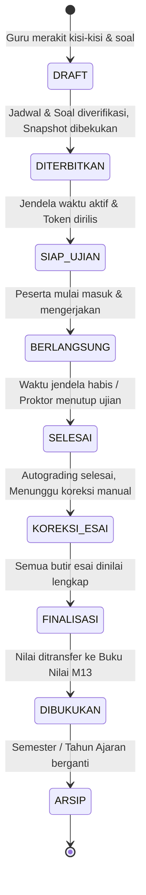
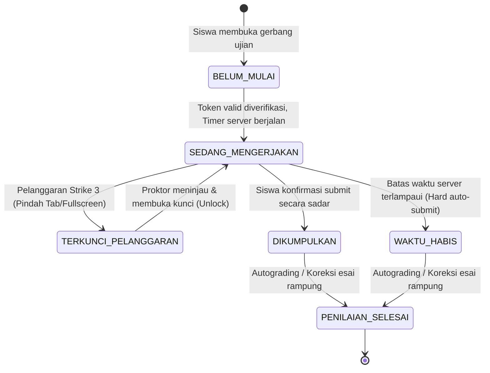
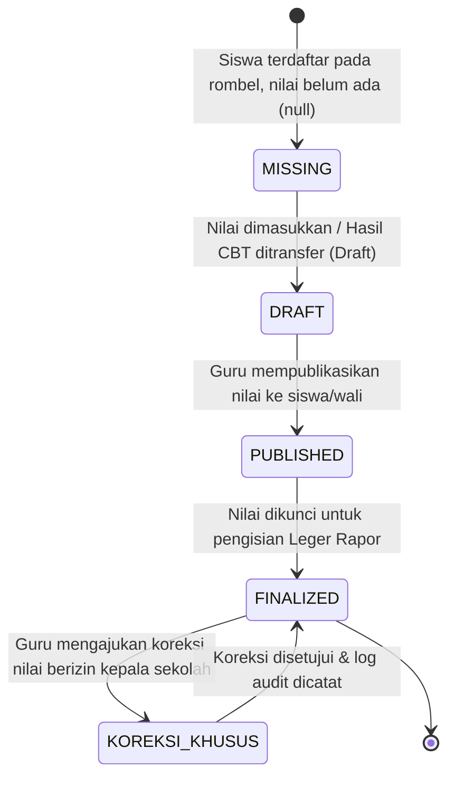

# ASSESSMENT DOMAIN MODEL
## Ruang Pintar — School Digital Operating Platform
### STAGE CBT-01: Pemodelan Domain, Agregat, Invariant & Kontrak State Machine

| Metadata | Nilai Canonical |
| --- | --- |
| **Produk / Sub-sistem** | Ruang Pintar — Assessment & Computer-Based Testing (CBT) Domain Model |
| **Kode Tahap** | `STAGE CBT-01` |
| **Status Dokumen** | `READY FOR HUMAN REVIEW` |
| **Klasifikasi Domain** | Bounded Context M13 (Assessment & Gradebook) + M14 (CBT Platform Engine) |
| **Versi Dokumen** | 2.0 (Domain Model Specification) |
| **Tanggal Audit & Desain** | 7 Oktober 2026 |
| **Dokumen Induk** | `docs/02-DOMAIN-MODEL.md`, `docs/03-MODULE-MAP.md`, `prisma/schema.prisma` |

---

# 1. Bounded Contexts dalam Assessment Engine

Assessment Engine Ruang Pintar dibagi menjadi 5 (lima) Bounded Context yang saling berkolaborasi dengan batas kewenangan (*separation of concerns*) yang tegas:

```text
┌────────────────────────────────────────────────────────────────────────┐
│                        ASSESSMENT ENGINE DOMAIN                        │
├────────────────────────────────────────────────────────────────────────┤
│ 1. QUESTION BANK & CONTENT CONTEXT                                     │
│    • Aset kurikulum sekolah reusable lintas tahun ajaran               │
│    • Butir soal multi-versi dengan pembobotan & stimulus kaya          │
├────────────────────────────────────────────────────────────────────────┤
│ 2. ASSESSMENT PLANNING & BLUEPRINT CONTEXT                             │
│    • Perencanaan evaluasi per TP, Lingkup Materi, dan Bobot Rapor      │
│    • Kisi-kisi instrumen (proporsi tingkat kesukaran & tipe soal)      │
├────────────────────────────────────────────────────────────────────────┤
│ 3. EXECUTION & SNAPSHOT DELIVERY CONTEXT                               │
│    • Pembekuan snapshot ujian instan (Zero-Trust Kunci Penilaian)      │
│    • Jendela penjadwalan & generator token dinamis pengawas            │
├────────────────────────────────────────────────────────────────────────┤
│ 4. ATTEMPT & PROCTORING CONTEXT                                        │
│    • Sesi pengerjaan siswa tunggal dengan timer server-authoritative   │
│    • Antrean autosave jawaban idempotent & pemantauan integritas layar │
├────────────────────────────────────────────────────────────────────────┤
│ 5. GRADING, PSYCHOMETRICS & GRADEBOOK CONTEXT                          │
│    • Autograding instan, koreksi esai butir per butir, psikometri P & D│
│    • Transfer resmi ke Leger Kurikulum Merdeka & Publikasi Terkendali  │
└────────────────────────────────────────────────────────────────────────┘
```

---

# 2. Entitas Domain, Value Objects & Agregat

### 2.1. Agregat 1: Question Bank (Bank Soal Reusable)
- **Root Agregat:** `BankSoal`
- **Entitas Pendukung:** `VersiSoal`, `FolderBankSoal`, `StimulusMedia`
- **Value Objects:**
  - `TipeSoal`: `PILIHAN_GANDA`, `PILIHAN_GANDA_KOMPLEKS`, `BENAR_SALAH`, `MENJODOHKAN`, `ISIAN_SINGKAT`, `ESAI`.
  - `TingkatKesulitan`: `MUDAH`, `SEDANG`, `SULIT`, `HOTS`.
  - `OpsiJawaban`: Array berurut `{ id: string, label: string, teks: string, urutan: number }`.
  - `KunciJawabanRahasia`: Data terenkripsi di server boundary `{ jawaban_benar: string[] }`.
  - `RubrikEsai`: Kriteria penilaian bertingkat `{ kriteria: string, skor_maks: number }[]`.
- **Invariant:**
  - Perubahan teks pada `BankSoal` wajib menciptakan `VersiSoal` baru dengan kenaikan `nomor_versi` bertahap.
  - Perubahan pada `BankSoal` tidak boleh mengubah naskah `SnapshotUjian` yang sedang atau sudah dikerjakan siswa.

### 2.2. Agregat 2: Assessment Definition & Blueprint
- **Root Agregat:** `DefinisiAsesmen`
- **Entitas Pendukung:** `UjianCbt`, `BlueprintItemConfig`
- **Value Objects:**
  - `KategoriAsesmen`: `FORMATIF`, `SUMATIF`, `SUMATIF_AKHIR`, `TUGAS`, `PRAKTIK`.
  - `TeknikPenilaian`: `TES_TERTULIS`, `TES_LISAN`, `PENUGASAN`, `KINERJA`, `PORTOFOLIO`.
  - `KktpThreshold`: Angka float kriteria ketuntasan (default 75.0).
  - `DeliveryMode`: `DIGITAL_CBT`, `HYBRID_PAPER_LJM`, `PERFORMANCE_RUBRIC`.
- **Invariant:**
  - `DefinisiAsesmen` wajib terikat pada satu `PenugasanMengajar` dan `Sekolah` yang valid.
  - `UjianCbt` adalah instrumen pelaksanaan digital dari `DefinisiAsesmen`.

### 2.3. Agregat 3: Exam Snapshot (Sumber Kebenaran Ujian)
- **Root Agregat:** `SnapshotUjian`
- **Value Objects:**
  - `ManifestSoalClient`: Struktur JSON soal yang dikirim ke peramban siswa (**mutlak tanpa kunci jawaban**).
  - `KunciPenilaianServer`: Struktur JSON kunci jawaban & formula pembobotan yang disimpan eksklusif di backend.
  - `NomorSnapshot`: Nomor versi snapshot stabil (beku saat status ujian dialihkan ke `DITERBITKAN`).
- **Invariant:**
  - `SnapshotUjian` bersifat *Append-Only & Immutable*; sekali dibekukan, dilarang dimutasi oleh guru selama sesi pengerjaan berlangsung.

### 2.4. Agregat 4: Exam Attempt & Proctoring
- **Root Agregat:** `SesiUjianSiswa`
- **Entitas Pendukung:** `JawabanSiswa`, `EventIntegritasUjian`
- **Value Objects:**
  - `AttemptStatus`: `BELUM_MULAI`, `SEDANG_MENGERJAKAN`, `TERKUNCI_PELANGGARAN`, `DIKUMPULKAN`, `WAKTU_HABIS`.
  - `ServerDeadline`: `waktu_mulai + durasi_menit` berbasis UTC/WIB server.
  - `AutosavePayload`: `{ soal_id, versi_id, jawaban_peserta, ragu_ragu, timestamp }`.
  - `IntegrityRecord`: `{ jenis_event, deskripsi, waktu_kejadian }`.
- **Invariant:**
  - Satu siswa hanya boleh memiliki **satu sesi aktif** (`SEDANG_MENGERJAKAN`) pada satu paket ujian pada satu waktu.
  - Jawaban siswa tidak boleh ditolak karena kendala jaringan; sistem mendukung penyimpanan asinkron *idempotent*.

### 2.5. Agregat 5: Grading, Psychometrics & Gradebook
- **Root Agregat:** `HasilUjianCbt` & `NilaiSiswa`
- **Entitas Pendukung:** `PublikasiNilaiAsesmen`, `AnalisisButirSoal`
- **Value Objects:**
  - `StatusPenilaian`: `LENGKAP`, `PERLU_KOREKSI_MANUAL`.
  - `StatusTransfer`: `BELUM_DITRANSFER`, `SUDAH_DITRANSFER`.
  - `PsychometricStats`: `{ indeks_kesukaran_P, daya_pembeda_D, efektivitas_distraktor }`.
- **Invariant:**
  - `Missing Grade ≠ Zero Grade`: Siswa yang tidak hadir atau belum dinilai memiliki `nilai_angka = null`.
  - `Skor Mentah ≠ Nilai Resmi`: Skor mentah CBT tidak otomatis menjadi nilai rapor sebelum divalidasi dan ditransfer oleh guru pengampu.

---

# 3. Invariant Domain Non-Negotiable (Aturan Baku)

Berikut adalah daftar invariant tak terlanggar (*non-negotiable rules*) yang menjadi kontrak domain:

```text
DM-CBT-001: Question Bank ≠ Question Version ≠ Exam Blueprint ≠ Exam Snapshot ≠ Exam Attempt
DM-CBT-002: Perubahan pada Bank Soal tidak boleh memengaruhi snapshot ujian yang sudah atau sedang berjalan.
DM-CBT-003: Manifest Soal yang dikirim ke client dilarang keras mengandung kunci jawaban atau indikator benar/salah.
DM-CBT-004: Jam server adalah satu-satunya sumber kebenaran (authoritative source of truth) untuk timer dan deadline ujian.
DM-CBT-005: Penilaian esai manual bersifat blind-grading untuk menjamin objektivitas guru penilai.
DM-CBT-006: Event Integritas adalah indikator telaah pengawas, bukan vonis diskualifikasi otomatis.
DM-GRADE-001: Nilai yang belum tersedia (missing grade) wajib bernilai null, dilarang diisi angka 0.
DM-GRADE-002: Penilaian CBT hanya diteruskan ke buku nilai (Gradebook M13) jika dikonfigurasi sebagai asesmen resmi.
DM-GRADE-003: Nilai yang sudah dibukukan ke Leger Akademik berstatus FINALIZED dan terkunci dari mutasi serampangan.
DM-TENANT-001: Seluruh query, mutasi, dan verifikasi sesi wajib menyertakan filter sekolah_id aktor aktif.
```

---

# 4. State Machines (Mesin Keadaan Siklus Hidup)

### 4.1. State Machine Ujian CBT (Exam Definition Lifecycle)



### 4.2. State Machine Sesi Pengerjaan Peserta Didik (Exam Attempt Lifecycle)



### 4.3. State Machine Nilai Siswa (Gradebook Lifecycle)



---

# 5. Domain Events & Transactional Outbox

Setiap transisi status kritis pada Assessment Engine memancarkan Domain Event ke tabel `OutboxPesan` untuk memastikan pemrosesan asinkron yang andal:

| Nama Domain Event | Pemicu (Trigger) | Muatan Payload (JSON) | Konsumen Hilir (Consumer) |
| --- | --- | --- | --- |
| `AssessmentCreatedEvent` | Guru membuat asesmen baru | `{ asesmenId, penugasanId, kategori, kktp }` | Modul Notifikasi, Kalender Akademik |
| `ExamSnapshotFrozenEvent` | Ujian diterbitkan | `{ ujianId, snapshotId, totalSoal, durasi }` | CBT Delivery Cache, Audit Engine |
| `AttemptStartedEvent` | Siswa memasukkan token valid | `{ attemptId, ujianId, siswaId, deadlineUtc }` | Live Proctor Cockpit, Audit Session |
| `IntegrityStrikeRecordedEvent` | Peramban mendeteksi blur/tab | `{ attemptId, jenisEvent, strikeCount }` | Live Proctor Cockpit Warning |
| `AttemptSubmittedEvent` | Sesi dikumpulkan / waktu habis | `{ attemptId, ujianId, durasiTerpakai }` | Autograding Worker, Proctor Grid |
| `ExamGradingCompletedEvent` | Seluruh penilaian tuntas | `{ ujianId, totalPeserta, rataRata }` | Psychometrics Worker, Guru Workspace |
| `GradeTransferredToLedgerEvent` | Nilai CBT dibukukan ke rapor | `{ ujianId, asesmenId, jumlahNilai }` | M13 Gradebook, e-Rapor Sync |
| `GradePublishedEvent` | Guru merilis nilai ke siswa/wali | `{ asesmenId, targetAudience, waktuRilis }` | Portal Siswa, Portal Wali Murid |

---

# 6. Pemetaan Model Data Relasional (Prisma Evolution)

Struktur model database pada `prisma/schema.prisma` saat ini telah memiliki fondasi model inti:
- `DefinisiAsesmen` & `NilaiSiswa` (M13)
- `PublikasiNilaiAsesmen` (M13)
- `BankSoal` & `VersiSoal` (M14)
- `UjianCbt`, `SnapshotUjian`, `SesiUjianSiswa`, `JawabanSiswa`, `HasilUjianCbt`, `EventIntegritasUjian` (M14)

### Evaluasi Kebutuhan Evolusi Skema Relasional:
1. **Model `FolderBankSoal`:** Sudah tersedia untuk kategorisasi bank soal terstruktur per bab/topik.
2. **Penyempurnaan Model `UjianCbt`:** Menambahkan kolom `mode_asesmen` (`FORMATIF` vs `SUMATIF`) dan `tipe_penyerahan` (`DIGITAL_CBT` vs `HYBRID_LJM`).
3. **Penyempurnaan Model `JawabanSiswa`:** Menambahkan kolom `skor_esai_manual` dan `rubrik_koreksi_json` untuk mendukung *blind grading* terverifikasi.
4. **Penyempurnaan Model `SnapshotUjian`:** Menjamin indeks `unique([ujian_cbt_id, nomor_snapshot])` serta pemisahan kolom `manifest_soal` (publik untuk peserta) dan `kunci_penilaian` (rahasia server-side).

---
*Dokumen ini merupakan bagian dari STAGE CBT-01 dan siap untuk ditinjau oleh Human Project Owner.*
