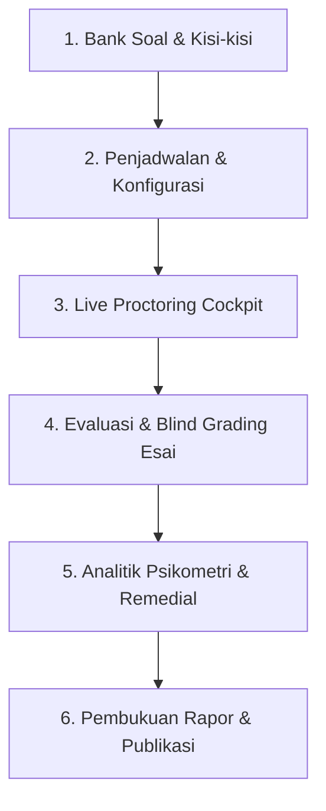
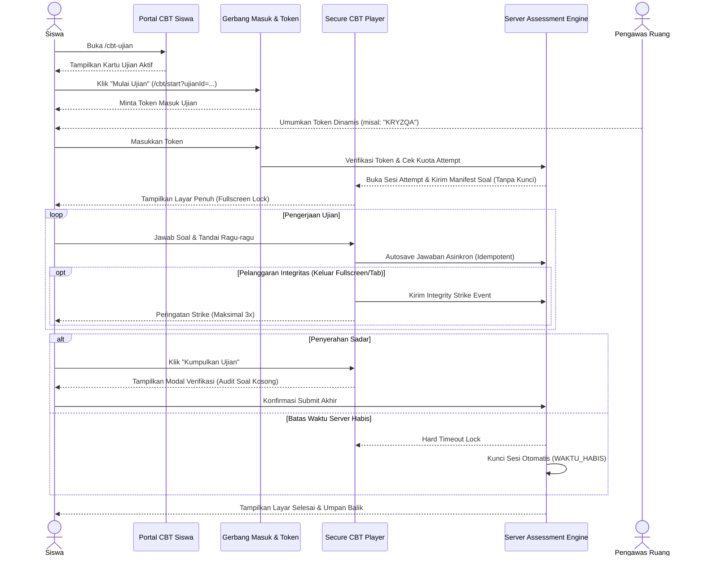

# ASSESSMENT USER FLOW & LIFECYCLE
## Ruang Pintar — School Digital Operating Platform
### STAGE CBT-01: Alur Bisnis Guru, Siswa, Proktor, Orang Tua & Skenario Pengecualian

| Metadata | Nilai Canonical |
| --- | --- |
| **Produk / Sub-sistem** | Ruang Pintar — Assessment & Computer-Based Testing (CBT) User Flow |
| **Kode Tahap** | `STAGE CBT-01` |
| **Status Dokumen** | `READY FOR HUMAN REVIEW` |
| **Aktor Utama** | Guru Pengampu, Pengawas Ruang (Proktor), Siswa Peserta, Orang Tua/Wali |
| **Versi Dokumen** | 2.0 (End-to-End User Flow Specification) |
| **Tanggal Audit & Desain** | 7 Oktober 2026 |
| **Dokumen Induk** | `docs/FRD.md`, `docs/USER-FLOW-MAP.md`, `docs/TEACHING-SESSION-WORKFLOW.md` |

---

# 1. Peta Alur Bisnis Guru (Teacher Workflow)

Alur kerja guru mencakup 6 fase operasional terpadu: dari perencanaan kisi-kisi hingga pembukuan nilai resmi ke e-Rapor.



### Fase 1: Perencanaan & Manajemen Bank Soal
1. **Navigasi:** Guru membuka menu `CBT Ujian Online` $\rightarrow$ `Bank Soal` (`/cbt-ujian/bank-soal`).
2. **Organisasi Folder & Topik:** Guru memilih Mata Pelajaran ampuan dan mengelompokkan soal ke dalam `FolderBankSoal` (misal: "Bab 1: Struktur Data", "STS Ganjil").
3. **Editor Soal Multi-Format (`/cbt-ujian/bank-soal/buat`):**
   - Guru memilih jenis soal: Pilihan Ganda, PG Kompleks (Multi-Jawaban), Benar/Salah, Menjodohkan, Isian Singkat, atau Esai.
   - Menggunakan toolbar kaya:
     - **Formula KaTeX:** Memilih simbol matematika/sains dari palet visual (akar, pecahan, integral, matriks).
     - **Teks Arab RTL:** Mengaktifkan mode tipografi Arab berharakat rapi.
     - **Stimulus Gambar:** Mengunggah berkas gambar diagram atau menempelkan (*paste*) langsung dari clipboard (Ctrl+V).
     - **Audio Listening:** Mengunggah file audio listening bahasa dan menetapkan batas maksimal putar (misal: 2x).
   - Menentukan kunci jawaban rahasia, bobot skor, tingkat kesulitan (Mudah/Sedang/Sulit/HOTS), dan mengaitkannya ke Tujuan Pembelajaran (TP).

### Fase 2: Perakitan Paket Ujian & Penjadwalan
1. Guru membuat paket asesmen dari menu `Jadwalkan Ujian Baru` (`/cbt-ujian/jadwal/buat` atau via tab Asesmen di `/kelas-saya`).
2. **Pemilihan Mode:**
   - **Mode Formatif:** Tanpa token ketat, pembahasan langsung aktif pasca pengumpulan, remedial instan.
   - **Mode Sumatif:** Fullscreen lock aktif, token dinamis proktor, pembahasan dirahasiakan, durasi ketat.
3. **Perakitan Soal (Blueprint):** Memilih butir-butir soal dari Bank Soal atau merakit otomatis berdasarkan persentase tingkat kesulitan.
4. **Konfigurasi Kebijakan:**
   - Jendela pelaksanaan: `waktu_mulai` dan `waktu_selesai`.
   - Durasi waktu pengerjaan (misal: 90 menit).
   - Opsi pengacakan: Acak urutan butir soal & acak urutan opsi jawaban (A–E).
   - Ambang Kriteria Ketuntasan Tujuan Pembelajaran (KKTP, default: 75.0).
5. **Verifikasi & Pembekuan Snapshot:** Guru mengonfirmasi penerbitan; sistem membekukan `SnapshotUjian` immutable dan memisahkan kunci penilaian ke brankas server.

### Fase 3: Pelaksanaan & Live Proctoring Cockpit (`/cbt-ujian/proctor/[ujianId]`)
1. Guru/Pengawas ruang membuka **Live Proctoring Cockpit** di layar proyektor atau monitor pengawas.
2. **Rilis Token Dinamis:** Pengawas menekan tombol rilis token untuk memunculkan kode 6-karakter (misal: `XK9PLM`) kepada siswa di ruang kelas fisik.
3. **Pemantauan Real-Time (Grid 36+ Siswa):**
   - Mengamati status pengerjaan siswa secara langsung: *Mengerjakan No. 14/30*, *Ragu-ragu 2*, *Koneksi Terputus*, atau *Terkunci Pelanggaran*.
4. **Tindakan Darurat Pengawas:**
   - Menekan **Buka Kunci** bagi siswa yang terblokir karena insiden notifikasi HP.
   - Menekan **Reset Sesi Perangkat** bagi siswa yang ganti HP/laptop karena baterai habis.
   - Menekan **+10 Menit Waktu** bagi siswa yang mengalami hambatan jaringan.
   - Menekan **Paksa Kumpul Seluruh Kelas** saat waktu ujian resmi telah selesai.

### Fase 4: Evaluasi & Skoring Campuran (`/cbt-ujian/evaluasi/[ujianId]`)
1. Butir soal objektif (PG, Menjodohkan, Benar/Salah) langsung dinilai otomatis oleh *Autograding Worker* (< 1 detik).
2. Untuk soal esai/uraian, guru masuk ke **Workspace Koreksi Esai (Blind Grading)**:
   - Guru mengoreksi jawaban esai siswa per nomor soal tanpa melihat identitas nama/foto siswa untuk menjamin objektivitas mutlak.
   - Memberikan skor berdasarkan rubrik panduan serta catatan umpan balik.
3. Sistem menghitung Nilai Akhir gabungan proporsional antara bobot objektif dan bobot esai.

### Fase 5: Analitik Psikometri & Remedial (`/cbt-ujian/analitik/[ujianId]`)
1. Guru memeriksa laporan statistik:
   - Sebaran kurva nilai rombel, rata-rata kelas, nilai tertinggi/terendah, dan standar deviasi.
   - **Tingkat Kesukaran ($P$):** Mengidentifikasi soal yang terlalu sukar ($P < 0.30$) atau terlalu mudah ($P > 0.70$).
   - **Daya Pembeda ($D$):** Mengidentifikasi butir soal cacat ($D < 0.20$) untuk dianulir atau direvisi.
   - **Efektivitas Distraktor:** Memeriksa opsi jawaban pengecoh yang tidak berfungsi.
2. Sistem secara otomatis menyusun daftar rekomendasi siswa yang belum tuntas KKTP untuk diikutsertakan dalam program remedial terfokus.

### Fase 6: Pembukuan Rapor & Publikasi Selektif
1. Guru menekan tombol satu-klik: **"Bukukan ke Buku Nilai (Gradebook M13)"**. Nilai resmi tersimpan permanen pada kolom sumatif rombel.
2. Guru memilih kebijakan publikasi (`PublikasiNilaiAsesmen`):
   - Merilis nilai dan pembahasan ke Siswa dan/atau Orang Tua/Wali.

---

# 2. Peta Alur Bisnis Siswa (Student Workflow)

Alur pengerjaan siswa dirancang fokus, berintegritas tinggi, bebas distraksi, dan terlindungi dari kendala teknis:



### Detail Langkah Pengalaman Siswa:
1. **Discovery & Kesiapan:** Siswa melihat jadwal asesmen di dashboard atau menu `CBT Ujian Online` (`/cbt-ujian`).
2. **Entry Gate & Token Validation:**
   - Siswa memeriksa nama mata pelajaran, durasi, dan nama guru pengampu.
   - Memasukkan token 6-karakter yang diumumkan oleh proktor di ruang kelas.
   - Menyetujui pakta integritas dan mengaktifkan mode layar penuh (*fullscreen*).
3. **Pengerjaan di Secure CBT Player (`/cbt/[attemptId]`):**
   - **Render Soal Kaya:** Membaca stimulus cerita, memperbesar gambar diagram dengan mengetuk gambar, mendengarkan audio listening (disertai indikator sisa putaran audio), dan membaca rumus KaTeX tajam.
   - **Timer Server Authoritative:** Melihat hitung mundur waktu yang tersinkronisasi presisi dengan jam server.
   - **Navigasi Fleksibel:** Berpindah butir soal melalui panel nomor, menandai opsi ragu-ragu (warna kuning), atau melihat daftar soal yang belum terisi (warna abu-abu).
   - **Resilient Autosave:** Setiap pilihan jawaban disimpan secara instan ke server; indikator "Tersimpan" hijau memberikan rasa tenang kepada siswa.
4. **Penyerahan & Verifikasi Akhir:**
   - Siswa menekan tombol **Kumpulkan Ujian**.
   - Modal konfirmasi menampilkan ringkasan: *"Anda telah menjawab 28 dari 30 soal. Masih ada 2 soal ragu-ragu. Yakin ingin mengumpulkan?"*
   - Setelah konfirmasi final, sesi dikunci permanen dan siswa dialihkan ke layar selesai.
5. **Pasca-Ujian:**
   - Pada mode formatif, siswa dapat langsung melihat perolehan skor dan pembahasan.
   - Pada mode sumatif, siswa melihat status pengerjaan selesai dan menunggu pengumuman nilai resmi dari guru pengampu.

---

# 3. Alur Kerja Pengawas Ruang (Proctor Workflow)

Bagi guru yang ditugaskan sebagai pengawas ruang ujian (baik guru pengampu maupun pengawas silang):

```text
┌────────────────────────────────────────────────────────────────────────┐
│                      ALUR PENGAWAS RUANG (PROKTOR)                     │
├────────────────────────────────────────────────────────────────────────┤
│ 1. LOGIN & BUKA COCKPIT                                                │
│    • Masuk ke /cbt-ujian/proctor/[ujianId]                             │
│    • Memverifikasi identitas rombel dan jumlah peserta hadir           │
├────────────────────────────────────────────────────────────────────────┤
│ 2. AKTIVASI & REGENERASI TOKEN                                         │
│    • Klik "Rilis Token Ujian" -> Tampilkan di papan tulis              │
│    • Opsi refresh token tiap 15 menit jika ada indikasi bocor ke luar  │
├────────────────────────────────────────────────────────────────────────┤
│ 3. LIVE MONITORING & MITIGASI INSIDEN                                  │
│    • Memantau kartu peserta: mendeteksi siswa yang offline / pasif     │
│    • Menangani siswa terkunci strike -> Buka Kunci (Unlock)            │
│    • Menangani perangkat mati -> Reset Device Sesi                     │
├────────────────────────────────────────────────────────────────────────┤
│ 4. PENUTUPAN UJIAN & BERITA ACARA                                      │
│    • Cek seluruh peserta telah berstatus SELESAI / DIKUMPULKAN         │
│    • Force submit bagi siswa yang lalai mengklik tombol selesai        │
│    • Cetak Berita Acara Ujian Resmi ber-rekap kehadiran & insiden      │
└────────────────────────────────────────────────────────────────────────┘
```

---

# 4. Alur Kerja Orang Tua / Wali Murid (Guardian Workflow)

1. **Notifikasi Jadwal Asesmen:** Wali murid menerima notifikasi bahwa anak memiliki jadwal Asesmen Sumatif pada tanggal tertentu.
2. **Pemantauan Perkembangan Belajar (`/nilai-anak`):**
   - Wali murid membuka tab perkembangan nilai pada portal wali.
   - **Perlindungan Integritas:** Wali murid **tidak memiliki akses** ke naskah butir soal yang bersifat rahasia sekolah sebelum ujian berakhir.
3. **Melihat Capaian Kompetensi Pasca-Publikasi:**
   - Setelah nilai dipublikasikan oleh guru, wali murid dapat melihat capaian nilai anak, deskripsi ketercapaian kompetensi Kurikulum Merdeka, serta catatan apresiasi/remedial dari guru.

---

# 5. Penanganan Kasus Khusus & Skenario Pengecualian (Edge Cases)

| Skenario Insiden | Dampak Sistem | Prosedur Penanganan Otomatis / Manual |
| --- | --- | --- |
| **Listrik Padam / Baterai HP Habis Mendadak** | Siswa logout paksa di tengah ujian. | 1. Siswa mengambil laptop/HP cadangan sekolah.  <br>2. Proktor mengklik tombol **"Reset Sesi Perangkat"** pada kartu siswa di Live Cockpit.  <br>3. Siswa login kembali dan memasukkan token. Seluruh jawaban sebelumnya pulih 100%. Sisa waktu melanjutkan deadline server. |
| **Koneksi WiFi Sekolah Drop Sementara** | Autosave ke server terputus sementara. | 1. Player CBT beralih ke mode *Offline Cache (IndexedDB/Local)*.  <br>2. Siswa tetap dapat membaca soal dan memilih jawaban tanpa macet.  <br>3. Saat jaringan pulih, antrean autosave mengirimkan mutasi jawaban secara *idempotent*. |
| **Siswa Terlambat Masuk Ruang Ujian** | Sisa jendela pelaksanaan resmi menipis. | 1. Pada mode *Strict Schedule Window*, sisa waktu berkurang secara proporsional.  <br>2. Jika keterlambatan disebabkan alasan darurat yang sah, pengawas dapat memberikan kompensasi waktu (+15 Menit) melalui aksi proktor. |
| **Pelanggaran Pindah Tab Berulang (Strike 3)** | Layar ujian terkunci permanen di peramban siswa. | 1. Sistem mencatat event `FULLSCREEN_EXIT` ke audit log.  <br>2. Kartu siswa di Live Cockpit berkedip merah dengan badge *Terkunci Pelanggaran*.  <br>3. Pengawas mendekati siswa, mengklarifikasi insiden, dan menekan tombol **"Buka Kunci"** dengan catatan teguran. |
| **Kebocoran Token Ujian ke Siswa Luar Kelas** | Siswa yang tidak hadir mencoba login dari rumah. | 1. Pengawas menekan tombol **"Regenerasi Token Baru"** di Cockpit.  <br>2. Token lama langsung hangus; peserta yang belum masuk wajib menggunakan token baru di papan tulis ruang kelas. |
| **Koreksi Nilai Pasca Finalisasi Buku Nilai** | Terjadi kesalahan input rubrik esai oleh guru. | 1. Nilai berstatus `FINALIZED` terkunci dari mutasi langsung.  <br>2. Guru membuka form *Permohonan Koreksi Nilai*, mengisi alasan revisi dan nilai baru.  <br>3. Log audit mencatat aktor, nilai sebelum, nilai sesudah, dan alasan koreksi demi akuntabilitas akademik institusi. |

---
*Dokumen ini merupakan bagian dari STAGE CBT-01 dan siap untuk ditinjau oleh Human Project Owner.*
