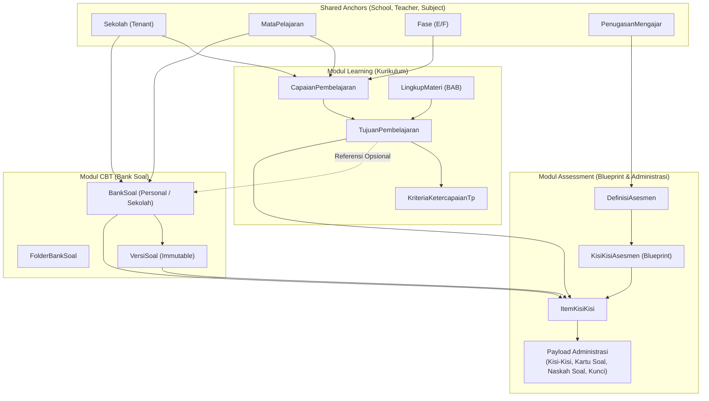

# CBT-02 DOMAIN MAPPING & INTER-MODULE CONTRACTS
## Ruang Pintar — School Digital Operating Platform
### STAGE CBT-02: Pemetaan Domain, Batas Modul, Kontrak Antar-Sistem & Otorisasi (MVP Only)

| Metadata | Nilai Canonical |
| --- | --- |
| **Produk / Sub-sistem** | Ruang Pintar — Assessment & Evaluation Foundation (M11, M13, M14) |
| **Kode Tahap** | `STAGE CBT-02` |
| **Status Dokumen** | `READY FOR HUMAN REVIEW (PLANNING ONLY — BELUM BOLEH CODING)` |
| **Prinsip Arsitektur** | Modular Monolith, Strict Bounded Contexts, Zero Domain Duplication |
| **Pola Relasi Modul** | Single Source of Truth per Subjek, Tenant-Scoped Context, Type-Safe DTOs |
| **Versi Dokumen** | 1.0 (Domain Mapping & Contracts) |
| **Tanggal Terbit** | 7 Oktober 2026 |

---

# 1. Analisis Batas Domain (Bounded Contexts & Anti-Duplication)

Untuk mencegah duplikasi model dan kebingungan tanggung jawab kode, arsitektur Ruang Pintar menetapkan pembagian tegas batas domain (*bounded contexts*) pada 3 modul inti:

```text
┌────────────────────────────────────────────────────────────────────────────────────────────────────────┐
│                                   PETA BOUNDED CONTEXT MODULAR MONOLITH                                │
├──────────────────────────────────┬─────────────────────────────────────┬───────────────────────────────┤
│ MODUL M11: LEARNING              │ MODUL M14: CBT & ITEM BANK          │ MODUL M13: ASSESSMENT         │
│ (Kurikulum & Pembelajaran)       │ (Repositori Soal & Mesin Ujian)     │ (Evaluasi & Administrasi)     │
├──────────────────────────────────┼─────────────────────────────────────┼───────────────────────────────┤
│ Tanggung Jawab:                  │ Tanggung Jawab:                     │ Tanggung Jawab:               │
│ • Capaian Pembelajaran (CP)      │ • Bank Soal (Butir Pertanyaan)      │ • Definisi Asesmen (Agenda)   │
│ • Lingkup Materi (BAB Pokok)     │ • Versi Soal (Snapshot Immutable)   │ • Kisi-Kisi Asesmen (Matriks) │
│ • Tujuan Pembelajaran (TP)       │ • Folder & Taksonomi Bank Soal      │ • Item Kisi-Kisi (Indikator)  │
│ • Kriteria Ketercapaian (KKTP)   │ • Paket Soal & Snapshot Perakitan   │ • Administrasi Naskah Cetak   │
│ • Konten Materi & Tugas Kelas    │ • Sesi Ujian & Pelaksanaan Tes      │ • Buku Nilai (Ledger / Rekap) │
├──────────────────────────────────┼─────────────────────────────────────┼───────────────────────────────┤
│ Entitas Utama:                   │ Entitas Utama:                      │ Entitas Utama:                │
│ • CapaianPembelajaran (Baru)     │ • BankSoal (Diperbarui scope & L1)  │ • DefinisiAsesmen             │
│ • LingkupMateri                  │ • VersiSoal                         │ • KisiKisiAsesmen (Baru)      │
│ • TujuanPembelajaran             │ • FolderBankSoal                    │ • ItemKisiKisi (Baru)         │
│ • KriteriaKetercapaianTp (Baru)  │ • PaketSoal & ItemPaketSoal         │ • NilaiSiswa                  │
│ • Materi & Tugas                 │ • UjianCbt & SesiUjianCbt           │ • DokumenAdministrasiPayload  │
└──────────────────────────────────┴─────────────────────────────────────┴───────────────────────────────┘
```

### Jaminan Pencegahan Duplikasi (Zero Duplication Guarantee)
1. **Tidak Ada "SoalAsesmen" vs "SoalCbt":** Seluruh butir soal dikelola **hanya** oleh modul `cbt` (`BankSoal` dan `VersiSoal`). Modul `assessment` hanya memegang referensi ID (`bank_soal_id` dan `versi_soal_id`) pada `ItemKisiKisi`.
2. **Tidak Ada "TargetNilai" vs "TujuanPembelajaran":** Target kompetensi dikelola **hanya** oleh modul `learning` (`TujuanPembelajaran` dan `KriteriaKetercapaianTp`). Modul `assessment` hanya mereferensikan `tujuan_pembelajaran_id`.
3. **Tidak Ada Jadwal Ganda:** Penjadwalan dan kaitan dengan Rombel/Mata Pelajaran dikelola oleh `DefinisiAsesmen` (M13) dan `UjianCbt` (M14) yang saling bertaut 1-to-1 (`ujian_cbt.definisi_asesmen_id`).

---

# 2. Invariants & Business Rules Inti

### 2.1. Curriculum Lineage Invariant
Kompetensi asesmen harus dapat dilacak (*traceable*) dari dokumen kurikulum negara hingga butir naskah ujian:
```text
Capaian Pembelajaran (CP) [Fase & Mapel]
       │
       ▼
Tujuan Pembelajaran (TP) [Kompetensi & Materi]
       │
       ▼
Kriteria Ketercapaian TP (KKTP) [Rubrik / Skala Interval]
       │
       ▼
Kisi-Kisi Asesmen (Blueprint) [Indikator Soal & Bobot]
       │
       ▼
Butir Soal (Bank Soal) [Stimulus, Opsi, Level Kognitif L1/L2/L3]
       │
       ▼
Naskah Asesmen / Kartu Soal / Ujian CBT
```

### 2.2. Dual Question Bank Ownership & Visibility Invariant
1. **Personal Question Bank (`PERSONAL`):**
   - **Pemilik Asal:** Guru pembuat (`guru_id`).
   - **Visibilitas:** Privat murni. Hanya guru pembuat dan Super Admin yang dapat melihat butir soal. Rekan sejawat guru lain **TIDAK DAPAT** melihat, menyalin, atau mengedit.
   - **Tujuan:** Ruang eksperimen dan bank soal pribadi guru yang belum divalidasi MGMP sekolah.
2. **School Question Bank (`SEKOLAH`):**
   - **Pemilik Asal:** MGMP / Bank Soal Resmi Sekolah.
   - **Visibilitas:** Kolaboratif satu sekolah. Seluruh guru yang memiliki penugasan mengajar mata pelajaran serumpun di sekolah tersebut dapat membaca (*read*) dan menyalin/memasukkan butir soal ke blueprint ujian kelas masing-masing.
   - **Hak Edit / Arsip:** Dibatasi untuk guru pembuat awal, Koordinator MGMP, atau Waka Kurikulum. Rekan guru biasa hanya memiliki hak baca dan pakai (*read & duplicate/reference*).
   - **Tenant Isolation:** Dilarang keras bank soal sekolah A diakses oleh guru sekolah B meskipun mata pelajarannya sama.

### 2.3. Immutable Question Versioning Invariant
- Setiap kali butir soal disunting (stimulus, opsi jawaban, kunci jawaban, rubrik), sistem **TIDAK** menimpa data lama secara langsung jika soal tersebut telah dipakai di naskah ujian atau kisi-kisi resmi.
- Sistem secara otomatis mencatat record baru di `VersiSoal` dengan `nomor_versi = n + 1`.
- `ItemKisiKisi` dan `ItemPaketSoal` menunjuk ke `versi_soal_id` spesifik. Naskah soal ujian yang sudah dicetak atau dikerjakan siswa dijamin tidak berubah (*freeze snapshot*).

---

# 3. Kontrak Ketergantungan Antar Modul (Dependency Graph)

Arah ketergantungan antar modul bersifat searah (*unidirectional*) tanpa circular dependency:



---

# 4. Data Transfer Objects (DTO) & Interfaces

Berikut adalah kontrak tipe data publik yang digunakan untuk komunikasi antar layer dan modul:

### 4.1. Kurikulum & Lineage DTOs (`src/modules/learning/domain/`)

```typescript
// DTO Capaian Pembelajaran
export interface CapaianPembelajaranDTO {
  id: string;
  sekolah_id: string;
  mata_pelajaran_id: string;
  fase_id: string;
  kode: string;
  elemen: string | null;
  deskripsi: string;
  urutan: number;
  status: "AKTIF" | "NONAKTIF" | "ARSIP";
  created_at: string;
  updated_at: string;
}

// DTO Kriteria Ketercapaian TP (KKTP)
export type TipeKktp = "SKALA_INTERVAL" | "RUBRIK_DESKRIPTIF" | "DAFTAR_KRITERIA";

export interface IntervalKktpItem {
  rentang_min: number;
  rentang_max: number;
  predikat: "PERLU_BIMBINGAN" | "CUKUP" | "BAIK" | "SANGAT_BAIK";
  tindak_lanjut: string;
}

export interface KriteriaKetercapaianTpDTO {
  id: string;
  sekolah_id: string;
  tujuan_pembelajaran_id: string;
  tipe_kktp: TipeKktp;
  ambang_tuntas: number; // e.g. 75.0
  interval_data: IntervalKktpItem[] | null;
  rubrik_data: Record<string, unknown>[] | null;
  deskripsi: string | null;
  created_at: string;
  updated_at: string;
}

// DTO Hirarki Lengkap Lineage (Untuk Picker Guru)
export interface CurriculumLineageHierarchyDTO {
  cp_id: string | null;
  cp_kode: string | null;
  cp_deskripsi: string | null;
  lingkup_materi_id: string;
  lingkup_materi_judul: string;
  tp_id: string;
  tp_kode: string;
  tp_deskripsi: string;
  kktp: KriteriaKetercapaianTpDTO | null;
}
```

### 4.2. Question Bank DTOs (`src/modules/cbt/domain/`)

```typescript
export type ScopeKepemilikanBankSoal = "PERSONAL" | "SEKOLAH";
export type LevelKognitif = "L1" | "L2" | "L3"; // L1: Pemahaman, L2: Aplikasi, L3: Penalaran/HOTS

export interface BankSoalHeaderDTO {
  id: string;
  sekolah_id: string;
  pembuat_guru_id: string;
  mata_pelajaran_id: string;
  folder_id: string | null;
  scope_kepemilikan: ScopeKepemilikanBankSoal;
  level_kognitif: LevelKognitif;
  kode: string | null;
  tipe_soal: string;
  tingkat_kesulitan: string;
  versi_aktif_nomor: number;
  pertanyaan_preview: string;
  is_shared_to_school: boolean;
  created_at: string;
  updated_at: string;
}
```

### 4.3. Assessment Blueprint & Administration DTOs (`src/modules/assessment/domain/`)

```typescript
export type StatusKisiKisi = "DRAFT" | "MENUNGGU_REVIEW" | "DISETUJUI" | "FINAL" | "ARSIP";

export interface ItemKisiKisiDTO {
  id: string;
  nomor_urut: number;
  tujuan_pembelajaran_id: string;
  tp_kode: string;
  tp_deskripsi: string;
  lingkup_materi_judul: string;
  indikator_soal: string;
  level_kognitif: LevelKognitif;
  bentuk_soal: string; // PILIHAN_GANDA, ESAI, dll.
  bobot_skor: number;
  bank_soal_id: string | null;
  versi_soal_id: string | null;
}

export interface KisiKisiAsesmenDTO {
  id: string;
  sekolah_id: string;
  definisi_asesmen_id: string;
  judul: string;
  tahun_ajaran: string;
  semester: string;
  alokasi_waktu_menit: number;
  total_butir_soal: number;
  status: StatusKisiKisi;
  items: ItemKisiKisiDTO[];
}

// Payload Siap Render untuk Administrasi Naskah
export interface KartuSoalPayloadDTO {
  sekolah_nama: string;
  sekolah_npsn: string;
  tahun_ajaran: string;
  semester: string;
  mata_pelajaran_nama: string;
  guru_penyusun_nama: string;
  nomor_soal: number;
  kompetensi_tp: string;
  materi_pokok: string;
  indikator_soal: string;
  level_kognitif: LevelKognitif;
  bentuk_soal: string;
  stimulus_teks: string | null;
  stimulus_gambar_url: string | null;
  teks_soal: string;
  kunci_jawaban: string;
  pedoman_penskoran: string;
}

export interface NaskahSoalCetakPayloadDTO {
  kop_surat: {
    nama_sekolah: string;
    alamat_sekolah: string;
    logo_url: string | null;
    judul_asesmen: string;
    mata_pelajaran: string;
    kelas_fase: string;
    hari_tanggal: string;
    alokasi_waktu: string;
  };
  petunjuk_umum: string[];
  daftar_soal: Array<{
    nomor: number;
    stimulus: string | null;
    stimulus_gambar: string | null;
    pertanyaan: string;
    opsi_jawaban: Array<{ label: string; teks: string }> | null;
    tipe: string;
  }>;
}
```

---

# 5. Skema Validasi Zod (Input Boundaries)

Setiap mutasi pada level Server Action / Application Service wajib melewati validasi skema Zod:

```typescript
import { z } from "zod";

// 1. Validasi Pembuatan Capaian Pembelajaran
export const createCapaianPembelajaranSchema = z.object({
  sekolah_id: z.string().length(26),
  mata_pelajaran_id: z.string().length(26),
  fase_id: z.string().length(26),
  kode: z.string().min(3).max(50),
  elemen: z.string().max(100).optional().nullable(),
  deskripsi: z.string().min(10).max(2000),
  urutan: z.number().int().min(1).default(1),
});

// 2. Validasi Kriteria Ketercapaian TP (KKTP)
export const createKktpSchema = z.object({
  sekolah_id: z.string().length(26),
  tujuan_pembelajaran_id: z.string().length(26),
  tipe_kktp: z.enum(["SKALA_INTERVAL", "RUBRIK_DESKRIPTIF", "DAFTAR_KRITERIA"]),
  ambang_tuntas: z.number().min(0).max(100).default(75.0),
  interval_data: z.array(z.object({
    rentang_min: z.number().min(0).max(100),
    rentang_max: z.number().min(0).max(100),
    predikat: z.enum(["PERLU_BIMBINGAN", "CUKUP", "BAIK", "SANGAT_BAIK"]),
    tindak_lanjut: z.string().min(3),
  })).optional().nullable(),
  deskripsi: z.string().max(1000).optional().nullable(),
});

// 3. Validasi Perubahan Scope Bank Soal (Personal -> School)
export const updateBankSoalScopeSchema = z.object({
  bank_soal_id: z.string().length(26),
  sekolah_id: z.string().length(26),
  target_scope: z.enum(["PERSONAL", "SEKOLAH"]),
  level_kognitif: z.enum(["L1", "L2", "L3"]).optional(),
});

// 4. Validasi Pembuatan Blueprint / Kisi-Kisi Asesmen
export const createKisiKisiSchema = z.object({
  sekolah_id: z.string().length(26),
  definisi_asesmen_id: z.string().length(26),
  judul: z.string().min(5).max(200),
  tahun_ajaran: z.string().regex(/^\d{4}\/\d{4}$/), // e.g. 2026/2027
  semester: z.enum(["GANJIL", "GENAP"]),
  alokasi_waktu_menit: z.number().int().min(10).max(300),
  items: z.array(z.object({
    nomor_urut: z.number().int().min(1),
    tujuan_pembelajaran_id: z.string().length(26),
    indikator_soal: z.string().min(5).max(500),
    level_kognitif: z.enum(["L1", "L2", "L3"]),
    bentuk_soal: z.string().min(3).max(50),
    bobot_skor: z.number().min(0.5).max(100),
    bank_soal_id: z.string().length(26).optional().nullable(),
  })).min(1),
});
```

---

# 6. Matriks Otorisasi & Pencegahan Kebocoran Data (Security & Tenant Isolation)

Setiap pemanggilan service atau database query wajib melalui penegakan otorisasi server-side:

| Peran Aktor (*Actor Role*) | Akses CP / TP | Akses Personal Bank (Milik Sendiri) | Akses Personal Bank (Guru Lain) | Akses School Bank (Mapel Serumpun) | Akses School Bank (Mapel Lain) | Pembuatan Blueprint & Naskah | Supervisi Dokumen Administrasi |
| :--- | :---: | :---: | :---: | :---: | :---: | :---: | :---: |
| **SUPER_ADMIN** | Full | Full (Audit) | Full (Audit) | Full | Full | Full | Full |
| **HEADMASTER / WAKAKUR** | Read-Only | Denied | Denied | Read-Only | Read-Only | Review / Lock | Read-Only (Supervisi) |
| **TEACHER (Pemilik / Owner)**| Full (Tugasnya)| Full (CRUD) | **DENIED (403)** | Read & Clone | Denied | Full (Kelasnya) | Full |
| **TEACHER (Rekan Serumpun)**| Read (Rumpun) | **DENIED (403)**| **DENIED (403)** | Read & Clone | Denied | Mandiri | Denied |
| **STUDENT** | Denied | **DENIED (403)**| **DENIED (403)** | **DENIED (403)**| **DENIED (403)**| **DENIED (403)** | **DENIED (403)** |
| **GUARDIAN** | Denied | **DENIED (403)**| **DENIED (403)** | **DENIED (403)**| **DENIED (403)**| **DENIED (403)** | **DENIED (403)** |

### Penegakan Query Isolasi Multi-Tenant
Semua Prisma queries wajib mematuhi pola:
```typescript
// CONTOH WAJIB POLA PENCEGAHAN DATA LEAKAGE:
const schoolQuestions = await prisma.bankSoal.findMany({
  where: {
    sekolah_id: tenantContext.sekolah_aktif_id, // WAJIB: Tenant isolator
    scope_kepemilikan: "SEKOLAH",
    mata_pelajaran_id: { in: actorAllowedMapelIds }, // WAJIB: Validasi serumpun
    status: "AKTIF",
  },
});
```

---

# 7. Penanganan Kasus Khusus (Edge Cases & Fallback)

1. **Kasus A: Guru belum mengisi Capaian Pembelajaran (CP):**
   - *Solusi:* Relasi `tujuan_pembelajaran.capaian_pembelajaran_id` bersifat opsional (`String?`). Guru tetap dapat membuat kisi-kisi dan mengaitkannya ke TP yang berada di bawah `LingkupMateri` tanpa CP. Sistem memberikan *soft warning* bahwa indikator kurikulum belum terhubung ke CP.
2. **Kasus B: Guru belum menyusun Kriteria Ketercapaian TP (KKTP):**
   - *Solusi:* Jika `KriteriaKetercapaianTp` belum diisi, sistem fallback ke nilai KKM umum yang tercantum di `DefinisiAsesmen.kkm_kktp` (default 75.0) dengan interval default pemerintah (0-60 Perlu Bimbingan, 61-75 Cukup, 76-85 Baik, 86-100 Sangat Baik).
3. **Kasus C: Butir Soal di Bank Soal belum memiliki Level Kognitif:**
   - *Solusi:* Kolom `level_kognitif` pada `BankSoal` memiliki nilai default `"L2"` (Aplikasi). Guru dapat mengubahnya kapan saja menjadi L1 atau L3 saat proses telaah butir soal atau saat perakitan kisi-kisi.
4. **Kasus D: Soal di Bank Soal diperbarui setelah Naskah Ujian Dicetak / Diterbitkan:**
   - *Solusi:* `ItemKisiKisi` mengikat `versi_soal_id` yang spesifik. Perubahan pada butir soal di Bank Soal menciptakan record versi baru dan **TIDAK** mengubah naskah cetak atau naskah ujian yang sudah dikunci (*locked*).
