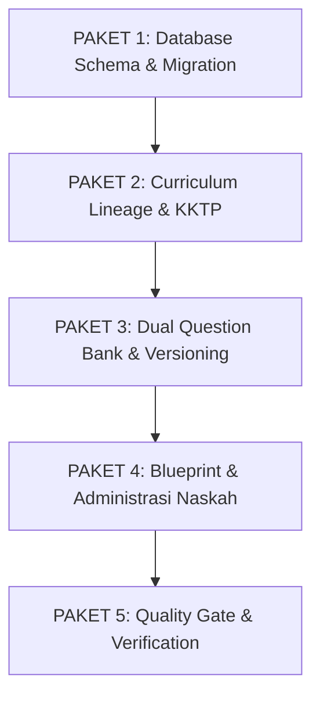

# CBT-02 IMPLEMENTATION PLAN
## Ruang Pintar — School Digital Operating Platform
### STAGE CBT-02: Rencana Implementasi Fondasi Asesmen, Kurikulum & Administrasi (MVP Only)

| Metadata | Nilai Canonical |
| --- | --- |
| **Produk / Sub-sistem** | Ruang Pintar — Assessment & Evaluation Foundation (M13 + M14 MVP) |
| **Kode Tahap** | `STAGE CBT-02` |
| **Status Dokumen** | `READY FOR HUMAN REVIEW (PLANNING ONLY — BELUM BOLEH CODING)` |
| **Klasifikasi Implementasi** | MVP Foundation (Data Layer, Application Services, Domain Mapping, Administrasi) |
| **Versi Dokumen** | 1.0 (Implementation Plan) |
| **Tanggal Terbit** | 7 Oktober 2026 |
| **Batasan Ketat** | *JANGAN CODING sebelum disetujui*, *JANGAN implementasi CBT Player/Proctoring/AI/Watchdog di tahap ini* |

---

# 1. Ruang Lingkup MVP (In-Scope vs Out-of-Scope)

STAGE CBT-02 berfokus **eksklusif pada fondasi domain, data, dan administrasi naskah**:

```text
┌────────────────────────────────────────────────────────────────────────────────────────┐
│                        SCOPE IMPLEMENTASI STAGE CBT-02 (MVP ONLY)                      │
├────────────────────────────────────────────────────────────────────────────────────────┤
│ [IN-SCOPE] FONDASI YANG DIKERJAKAN:                                                    │
│ 1. Kurikulum Assessment Lineage:                                                       │
│    • Integrasi Capaian Pembelajaran (CP) Fase & Mata Pelajaran                         │
│    • Tujuan Pembelajaran (TP) & Kriteria Ketercapaian (KKTP Interval/Rubrik)           │
│    • Lineage Tracing: CP -> TP -> KKTP -> Kisi-Kisi -> Soal                            │
│ 2. Question Bank Foundation:                                                           │
│    • Personal Question Bank (Privat Guru) vs School Question Bank (Aset MGMP)          │
│    • Aturan Kepemilikan (Ownership & Visibility Rules) & Tenant Isolation              │
│    • Question Versioning Foundation (Perubahan soal tidak merusak naskah lama)         │
│ 3. Assessment Blueprint:                                                               │
│    • Blueprint Builder (Perakit Kisi-Kisi Matriks Supervisi)                          │
│    • Pemetaan Indikator TP, Bobot Skor, dan Level Kognitif (L1 / L2 / L3)              │
│ 4. Assessment Administration Foundation:                                               │
│    • Generator Kisi-Kisi Ujian Resmi                                                   │
│    • Generator Kartu Soal per Butir Soal                                               │
│    • Generator Naskah Soal Ujian (Format 2 Kolom PDF ber-Kop Surat Sekolah)            │
│    • Generator Kunci Jawaban & Rubrik Penskoran                                        │
├────────────────────────────────────────────────────────────────────────────────────────┤
│ [STRICTLY OUT-OF-SCOPE] DILARANG DIKERJAKAN PADA STAGE CBT-02:                         │
│ • CBT Player (Layar Pengerjaan Siswa)               -> Phase 2                         │
│ • Live Proctoring Cockpit / WebSocket Monitoring     -> Phase 2                         │
│ • Dynamic Rolling Token / Watchdog Strike 3x Lock   -> Phase 3                         │
│ • AI Assessment Assistant (Gemini Generator/Analyzer) -> Phase 2                         │
│ • Analitik Psikometri Ilmiah (P & D)                 -> Phase 2                         │
│ • Koreksi Esai Manual (Blind Grading Workspace)      -> Phase 2                         │
│ • Computerized Adaptive Testing (CAT)                -> Phase 3                         │
└────────────────────────────────────────────────────────────────────────────────────────┘
```

---

# 2. Urutan Langkah Kerja Teknis (Sequential Work Breakdown)

Pekerjaan implementasi akan dijalankan dalam 4 paket terurut dengan gerbang verifikasi ketat:



### Paket 1: Database Schema & Migration Foundation
1. **Analisis Kompatibilitas:** Memastikan skema baru tidak merusak data `BankSoal`, `VersiSoal`, `LingkupMateri`, dan `TujuanPembelajaran` yang telah ada.
2. **Definisi Model Skema Prisma:**
   - Menambahkan model `CapaianPembelajaran` terhubung ke `MataPelajaran`, `Fase`, dan `Sekolah`.
   - Menambahkan model `KriteriaKetercapaianTp` (KKTP) terhubung ke `TujuanPembelajaran`.
   - Menambahkan model `KisiKisiAsesmen` dan `ItemKisiKisi` terhubung ke `DefinisiAsesmen` dan `TujuanPembelajaran`.
   - Memperbarui model `BankSoal` dengan kolom `scope_kepemilikan` (`PERSONAL` | `SEKOLAH`) dan `level_kognitif` (`L1` | `L2` | `L3`).
3. **Eksekusi Migrasi Aman:** Membuat migrasi forward `add_assessment_foundation_and_curriculum_lineage` tanpa menghapus data tabel eksisting.

### Paket 2: Domain Services & Curriculum Lineage (CP $\rightarrow$ TP $\rightarrow$ KKTP)
1. Menyiapkan DTO dan validasi Zod untuk CP dan KKTP di `src/modules/learning/` atau `src/modules/academic/`.
2. Menyusun service layer untuk membaca hierarki CP $\rightarrow$ TP $\rightarrow$ KKTP per rombel dan mata pelajaran.
3. Memastikan fallback toleran: jika guru belum mengisi CP, guru tetap dapat menggunakan TP yang sudah ada pada `LingkupMateri`.

### Paket 3: Dual Question Bank & Ownership Enforcement
1. Memperbarui `CbtRepository` dan `CbtService`:
   - `getPersonalQuestions(sekolahId, guruId, filter)`: Hanya menampilkan soal milik guru tersebut.
   - `getSchoolQuestions(sekolahId, mapelId, filter)`: Menampilkan soal berstatus `SEKOLAH` untuk guru serumpun mata pelajaran.
   - `shareToSchoolBank(bankSoalId, sekolahId, guruId)`: Menyalin atau mempromosikan soal dari Personal ke School Bank.
2. Menegakkan aturan integritas versi (*immutable versioning*): Perubahan teks butir soal otomatis menaikkan nomor versi soal tanpa merusak snapshot lama.

### Paket 4: Blueprint Builder & Assessment Administration
1. Menyusun application service `AssessmentBlueprintService` di `src/modules/assessment/application/`:
   - Membuat draf kisi-kisi asesmen resmi.
   - Memetakan indikator soal ke level kognitif L1/L2/L3 dan butir `BankSoal`.
2. Menyusun generator dokumen administrasi resmi di `src/modules/assessment/infrastructure/`:
   - Generator payload **Kisi-Kisi Ujian** (Format tabel standar pengawas dinas).
   - Generator payload **Kartu Soal per Butir** (Telaah butir soal, stimulus, kunci, rubrik penskoran).
   - Generator payload **Naskah Soal Resmi** (Format 2 kolom kop surat sekolah).
   - Generator payload **Kunci Jawaban & Pedoman Penskoran**.

### Paket 5: Quality Gate & Verification
1. Penulisan unit tests di `src/test/assessment/` dan `src/test/cbt/`.
2. Eksekusi Quality Gate: `npm run typecheck`, `npm run lint`, `npm run format:check`, `npm run test`, `npm run build`.

---

# 3. Kriteria Selesai (Definition of Done — DoD)

STAGE CBT-02 dinyatakan selesai apabila seluruh kriteria berikut terpenuhi secara faktual:
1. **Zero Domain Duplication:** Tidak ada entitas atau modul tumpang tindih; TP menggunakan master eksisting di M11, Bank Soal di M14 diperkaya kepemilikannya, dan Kisi-kisi terhubung ke M13.
2. **Strict Tenant Isolation:** Kueri Bank Soal Personal, Bank Soal Sekolah, dan Kisi-kisi terisolasi mutlak pada `sekolah_id` dan `guru_id` yang sah.
3. **Data Immutability:** Naskah soal lama dan penugasan mengajar historis tidak terpengaruh oleh penambahan versi baru.
4. **Dokumen Administrasi Tervalidasi:** Data Kisi-Kisi, Kartu Soal, Naskah Soal, dan Kunci Jawaban dapat digenerate lengkap dengan kop surat sekolah.
5. **Quality Gate 100% Clean:** TypeScript (0 errors), ESLint (0 errors), Prettier (clean), Vitest suite passing, dan Next.js production build lulus.

---
*Rencana ini disusun untuk mendapatkan persetujuan dari Human Project Owner sebelum instruksi pengkodean dimulai.*
