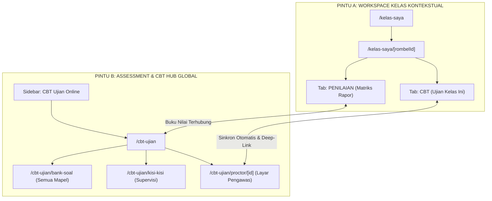

# TEACHER ASSESSMENT NAVIGATION ARCHITECTURE
## Ruang Pintar — School Digital Operating Platform
### STAGE CBT-01.1: Pola Navigasi, Hierarki Rute & Interaksi Ergonomis Desktop & Mobile

| Metadata | Nilai Canonical |
| --- | --- |
| **Produk / Sub-sistem** | Ruang Pintar — Teacher Assessment Navigation System |
| **Kode Tahap** | `STAGE CBT-01.1` |
| **Status Dokumen** | `READY FOR HUMAN REVIEW` |
| **Klasifikasi Modul** | Navigation & UX Interaction Architecture |
| **Versi Dokumen** | 1.0 (Teacher Navigation Blueprint) |
| **Tanggal Terbit** | 7 Oktober 2026 |
| **Prinsip Utama** | *3-Click Maximum Rule*, *Dual-Entry Routing*, *Zero Full-Page Reload*, *Thumb-Zone Mobile Ergonomics* |

---

# 1. Konsep Dasar & Arsitektur Dual-Entry

Untuk mengakomodasi kebiasaan kerja guru yang berbeda-beda, sistem menyediakan **2 Pintu Masuk Navigasi Utama** yang saling terhubung secara mulus (*seamless cross-linking*):



- **Pintu A (Contextual Class Workspace):** Digunakan saat guru sedang fokus mengelola KBM kelas tertentu (misal: "Hari ini saya mengajar X RPL 1, saya ingin melihat nilai tugas dan mengadakan kuis kilat").
- **Pintu B (Global Assessment Hub):** Digunakan saat guru sedang menyiapkan instrumen besar lintas kelas (misal: "Saya ingin menyusun Bank Soal semester untuk semua rombel, atau mencetak berkas administrasi kisi-kisi dan berita acara untuk kepala sekolah").

---

# 2. Matriks Struktur Rute URL & Akses Hak Kelola

| Rute URL | Nama Tampilan | Peruntukan & Konten Utama | Breadcrumbs Navigasi |
| --- | --- | --- | --- |
| `/cbt-ujian` | **Assessment & CBT Hub** | Ikhtisar seluruh kelas, ujian aktif hari ini, antrean koreksi, tautan bank soal | `Dashboard > CBT Ujian Online` |
| `/cbt-ujian/bank-soal` | **Bank Soal Terpadu** | Tab Personal Bank & Tab School Bank, hierarki folder bab/topik | `Dashboard > CBT > Bank Soal` |
| `/cbt-ujian/bank-soal/buat` | **Editor Butir Soal** | Kanvas editor soal: KaTeX Math, Arab RTL, stimulus gambar/audio | `Dashboard > CBT > Bank Soal > Buat Soal` |
| `/cbt-ujian/kisi-kisi` | **Pusat Kisi-Kisi** | Matriks resmi CP $\rightarrow$ TP $\rightarrow$ Indikator Soal $\rightarrow$ Level Kognitif | `Dashboard > CBT > Kisi-Kisi & Blueprint` |
| `/cbt-ujian/jadwal/buat` | **Wizard Asesmen** | Wizard 3 langkah: Pilih TP/Kisi-kisi $\rightarrow$ Konfigurasi Durasi/Rombel $\rightarrow$ Terbitkan | `Dashboard > CBT > Jadwal Ujian Baru` |
| `/cbt-ujian/proctor/[id]` | **Live Proctor Cockpit** | Pemantauan waktu nyata status 36+ siswa, rilis token, kontrol reset sesi | `Dashboard > CBT > [Nama Ujian] > Proctor` |
| `/cbt-ujian/evaluasi/[id]` | **Workspace Koreksi Esai**| Ruang koreksi esai *blind grading* (identitas siswa disamarkan per butir) | `Dashboard > CBT > [Nama Ujian] > Evaluasi` |
| `/cbt-ujian/analitik/[id]` | **Analitik Psikometri** | Laporan ilmiah: Indeks kesukaran $P$, daya beda $D$, sebaran distraktor | `Dashboard > CBT > [Nama Ujian] > Analitik` |
| `/cbt-ujian/administrasi/[id]`| **Pusat Berkas Cetak** | Unduh & cetak 1-klik: Berita Acara, Naskah PDF kop surat, Kartu Soal | `Dashboard > CBT > [Nama Ujian] > Berkas` |
| `/penilaian` | **Buku Nilai Global** | Ikhtisar seluruh buku nilai penugasan mengajar guru | `Dashboard > Buku Nilai & Penilaian` |
| `/kelas-saya/[id]?tab=CBT` | **Tab CBT Kelas** | Daftar ujian spesifik kelas, hasil skor, dan tombol transfer rapor | `Kelas Saya > [Nama Rombel] > CBT` |

---

# 3. Penegakan Aturan Maksimal 3 Klik (3-Click Rule Enforcement)

Untuk memastikan alur tidak membingungkan guru di lapangan:

```text
┌────────────────────────────────────────────────────────────────────────────────────────┐
│               PEMBUKTIAN 3-CLICK RULE UNTUK AKTIVITAS KRITIS GURU                      │
├────────────────────────────────────────────────────────────────────────────────────────┤
│ SKENARIO 1: MEMANTAU SISWA UJIAN (PROCTORING)                                          │
│ Klik 1: Buka menu "CBT Ujian Online" dari Sidebar                                      │
│ Klik 2: Klik tombol "Pantau Ruang Ujian" pada Kartu Ujian Aktif Hari Ini               │
│ HASIL: Guru langsung berada di Live Proctor Cockpit! (Hanya 2 Klik)                   │
├────────────────────────────────────────────────────────────────────────────────────────┤
│ SKENARIO 2: KOREKSI ESAI SISWA                                                         │
│ Klik 1: Buka menu "CBT Ujian Online"                                                   │
│ Klik 2: Klik badge merah "4 Siswa Perlu Koreksi"                                       │
│ HASIL: Guru langsung berada di Workspace Blind Grading! (Hanya 2 Klik)                 │
├────────────────────────────────────────────────────────────────────────────────────────┤
│ SKENARIO 3: CETAK BERITA ACARA UJIAN SUPERVISI                                         │
│ Klik 1: Buka tab CBT di ruang kelas (/kelas-saya/[id])                                 │
│ Klik 2: Klik ikon Printer [ 🖨️ Cetak Administrasi ]                                    │
│ Klik 3: Pilih [ Cetak Berita Acara PDF ]                                               │
│ HASIL: Dokumen PDF resmi ber-kop surat langsung terbuka siap print! (Tepat 3 Klik)     │
├────────────────────────────────────────────────────────────────────────────────────────┤
│ SKENARIO 4: SINKRONISASI SKOR CBT KE BUKU NILAI RAPOR                                  │
│ Klik 1: Buka tab CBT di kelas aktif                                                    │
│ Klik 2: Klik tombol "Bukukan ke Buku Nilai"                                            │
│ Klik 3: Konfirmasi dialog pop-up                                                       │
│ HASIL: Nilai tersalin resmi ke Leger Rapor M13! (Tepat 3 Klik)                         │
└────────────────────────────────────────────────────────────────────────────────────────┘
```

---

# 4. Pola Navigasi Desktop vs Ponsel Pintar (Desktop vs Mobile)

### 4.1. Pola Navigasi Desktop (Large Screen Experience)
1. **Sidebar Navigation Rail:** Sidebar biru navy Academic Glass persisten di sebelah kiri.
2. **Horizontal Sub-Navigation Glass Tabs:** Bilah tab melayang di bawah header kelas (`Ringkasan`, `Presensi`, `Materi`, `Tugas`, `Penilaian`, `CBT`).
3. **Dual-Panel Workspace:** Panel kiri menampilkan daftar peserta / butir soal, panel kanan menampilkan lembar kerja / formulir aktif.
4. **Floating Assistant Copilot Drawer:** Laci samping di sudut kanan bawah (`[ ✨ Asisten AI ]`) yang dapat dibuka-tutup tanpa meninggalkan halaman pengerjaan.

### 4.2. Pola Navigasi Mobile (Smartphone Cockpit Experience)
Guru di Indonesia sering mengawasi ujian sambil berkeliling ruang kelas membawa HP:
1. **Ergonomi Zona Jempol (Thumb-Zone Optimization):** Seluruh tombol navigasi kritis dan tombol darurat diletakkan pada sepertiga area bawah layar yang mudah dijangkau satu tangan.
2. **Sticky Quick Status Header:** Menampilkan Token Ujian besar (font mono tebal) dan sisa waktu di bagian atas layar agar guru dapat membacanya sekilas sambil berjalan.
3. **Card-Based Swipeable Views:** Transisi antar-status siswa menggunakan kartu vertikal yang dapat digeser (*swipe*).
4. **Bottom Sheet Dialogs (Bukan Popup Modal Sempit):** Tindakan aksi seperti konfirmasi Reset Sesi atau Buka Kunci muncul dari bawah layar (*slide-up bottom sheet*), ramah sentuhan jempol.

```text
┌─────────────────────────────────┐
│ [<-] UJIAN STS — X TO 3         │ <- Header Ringkas
│ Token: K R Y Z Q A • 00:45:10   │
├─────────────────────────────────┤
│ [Semua (36)] [Mengerjakan (34)] │ <- Segmented Pills Horizontal
├─────────────────────────────────┤
│ ┌─────────────────────────────┐ │
│ │ 01. Ahmad Fatoni            │ │
│ │ Soal 18/25 • Status: AMAN   │ │
│ └─────────────────────────────┘ │
│ ┌─────────────────────────────┐ │
│ │ 02. Andika Rizky            │ │
│ │ Soal 12/25 • TERKUNCI (!)   │ │
│ │ [ BUKA KUNCI ] [ RESET HP ] │ │ <- Tombol Aksi Jempol Ramah Sentuh
│ └─────────────────────────────┘ │
│ ┌─────────────────────────────┐ │
│ │ 03. Cindy Permata           │ │
│ │ Soal 24/25 • Ragu: 2        │ │
│ └─────────────────────────────┘ │
├─────────────────────────────────┤
│ [ ⚡ AKSI PENGAWAS CEPAT ]      │ <- Sticky Bottom Action Bar
└─────────────────────────────────┘
```

---

# 5. Penanganan State & Ketahanan Navigasi (State Preservation)

1. **Zero Full-Page Reload:** Pergantian antar-tab di dalam ruang kerja menggunakan *client-side state transition* dengan URL search params yang bersih (misal: `/kelas-saya/[id]?tab=CBT&ujianId=[ujianId]`).
2. **Deep-Link Shareable:** Guru pengawas silang dapat membuka URL tautan proctoring secara langsung melalui pesan WhatsApp dari panitia ujian tanpa harus login berulang kali jika sesi aktif.
3. **Form Auto-Save Draft:** Saat guru mengetik naskah soal atau kisi-kisi, draf otomatis tersimpan ke *local storage*, sehingga jika peramban tidak sengaja tertutup atau baterai laptop habis, ketikan naskah tidak hilang.

---
*Dokumen ini merupakan bagian resmi dari STAGE CBT-01.1 dan siap untuk ditinjau oleh Human Project Owner.*
