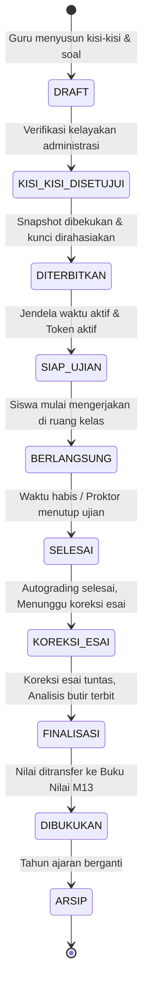
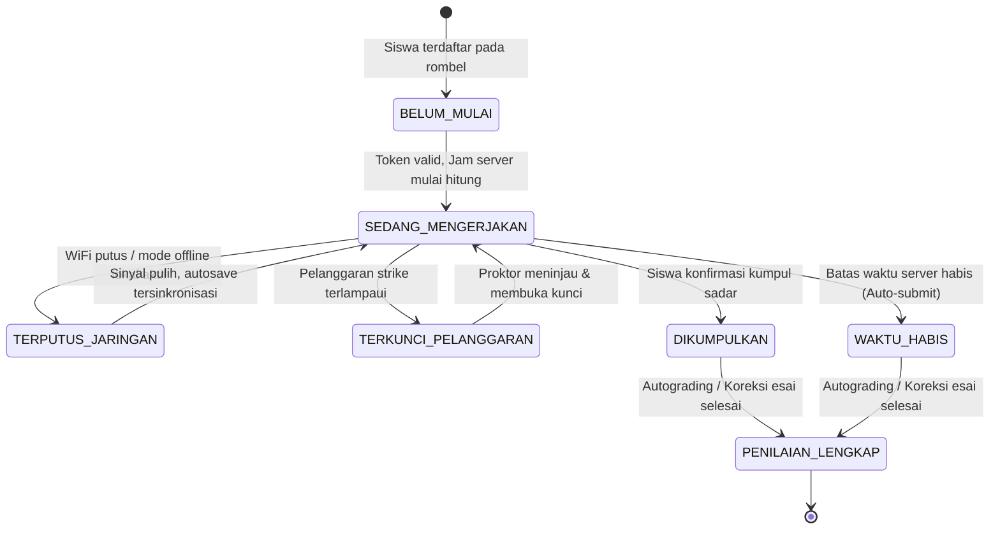

# UPDATED ASSESSMENT DOMAIN MODEL
## Ruang Pintar — School Digital Operating Platform
### STAGE CBT-01: Pemodelan Domain Kurikulum Merdeka, Administrasi Ujian, Kepemilikan Bank Soal & Asisten AI

| Metadata | Nilai Canonical |
| --- | --- |
| **Produk / Sub-sistem** | Ruang Pintar — Assessment & Evaluation Domain Model |
| **Kode Tahap** | `STAGE CBT-01 (REFINED)` |
| **Status Dokumen** | `READY FOR HUMAN REVIEW` |
| **Klasifikasi Domain** | Bounded Context M13 (Assessment & Gradebook) + M14 (CBT Platform) + Kurikulum & Administrasi |
| **Versi Dokumen** | 3.0 (Comprehensive Domain Model Specification) |
| **Tanggal Terbit** | 7 Oktober 2026 |
| **Dokumen Induk** | `docs/02-DOMAIN-MODEL.md`, `docs/03-MODULE-MAP.md`, `prisma/schema.prisma` |

---

# 1. Bounded Context Map (8 Bounded Contexts)

Untuk mengakomodasi kebutuhan operasional riil sekolah di Indonesia, domain Assessment Engine dikembangkan menjadi 8 (delapan) Bounded Context:

```text
┌────────────────────────────────────────────────────────────────────────────────────────┐
│                        ASSESSMENT ENGINE BOUNDED CONTEXTS                              │
├────────────────────────────────────────────────────────────────────────────────────────┤
│ 1. CURRICULUM LINEAGE CONTEXT                                                          │
│    • Capaian Pembelajaran (CP), Tujuan Pembelajaran (TP), Interval KKTP                │
│    • Pemetaan kompetensi dasar dan indikator keberhasilan akademik                     │
├────────────────────────────────────────────────────────────────────────────────────────┤
│ 2. QUESTION BANK & OWNERSHIP CONTEXT                                                   │
│    • Personal Question Bank (Privat Guru) & School Question Bank (Aset MGMP)           │
│    • Versi Soal Stabil, Stimulus Kaya (KaTeX, Arab RTL, Audio), Opsi, & Rubrik         │
├────────────────────────────────────────────────────────────────────────────────────────┤
│ 3. ASSESSMENT PLANNING & BLUEPRINT CONTEXT                                             │
│    • Kisi-kisi Asesmen (Matriks Level Kognitif L1/L2/L3 & Bentuk Soal)                 │
│    • Definisi Asesmen, Bobot Rapor, dan Kategori Formatif / Sumatif                    │
├────────────────────────────────────────────────────────────────────────────────────────┤
│ 4. ASSESSMENT ADMINISTRATION CONTEXT                                                   │
│    • Kartu Soal per Butir, Naskah Soal Resmi Cetak PDF ber-Kop Surat                   │
│    • Kunci Jawaban & Rubrik, Daftar Hadir Peserta Ujian, Berita Acara Pengawas         │
├────────────────────────────────────────────────────────────────────────────────────────┤
│ 5. EXECUTION & SNAPSHOT DELIVERY CONTEXT                                               │
│    • Snapshot Ujian Immutable (Zero-Trust Kunci Penilaian)                             │
│    • Penjadwalan Jendela Waktu & Token Sesi Standar                                    │
├────────────────────────────────────────────────────────────────────────────────────────┤
│ 6. ATTEMPT & PROCTORING CONTEXT                                                        │
│    • Sesi Pengerjaan Siswa Tunggal, Timer Server-Authoritative                         │
│    • Antrean Autosave Idempotent & Log Integritas Humanis (Bukan Vonis Otomatis)       │
├────────────────────────────────────────────────────────────────────────────────────────┤
│ 7. GRADING & PSYCHOMETRICS CONTEXT                                                     │
│    • Autograding Butir Objektif & Blind Grading Butir Esai Manual                      │
│    • Analisis Butir Soal Ilmiah (Tingkat Kesukaran P, Daya Pembeda D, Distraktor)      │
├────────────────────────────────────────────────────────────────────────────────────────┤
│ 8. AI ASSESSMENT ASSISTANT CONTEXT                                                     │
│    • Job Generatif (Kisi-kisi, Soal, Distraktor, Pembahasan, Remedial)                 │
│    • Job Analitis (Diagnosis Ketuntasan TP, Evaluasi Kualitas Instrumen)               │
└────────────────────────────────────────────────────────────────────────────────────────┘
```

---

# 2. Entitas Domain, Value Objects & Agregat

### 2.1. Agregat 1: Curriculum Lineage (CP $\rightarrow$ TP $\rightarrow$ KKTP)
- **Root Agregat:** `CapaianPembelajaran`
- **Entitas Pendukung:** `TujuanPembelajaran`, `KriteriaKetercapaianTp` (KKTP)
- **Value Objects:**
  - `FasePendidikan`: `FASE_A`, `FASE_B`, `FASE_C`, `FASE_D`, `FASE_E`, `FASE_F`.
  - `TipeKktp`: `RUBRIK_DESKRIPTIF`, `SKALA_INTERVAL`, `DAFTAR_KRITERIA`.
  - `IntervalSkorKktp`: `{ batas_bawah: number, batas_atas: number, predikat: string, tindak_lanjut: string }`.
- **Invariant:**
  - Setiap butir soal wajib memiliki relasi ke minimal satu `TujuanPembelajaran`.
  - Satu `TujuanPembelajaran` wajib menginduk pada satu `CapaianPembelajaran` yang sah.

### 2.2. Agregat 2: Question Bank & Ownership
- **Root Agregat:** `BankSoal`
- **Entitas Pendukung:** `VersiSoal`, `FolderBankSoal`
- **Value Objects:**
  - `ScopeKepemilikan`: `PERSONAL`, `SEKOLAH`.
  - `HakAksesBankSoal`: `OWNER_FULL`, `MGMP_USE_ONLY` (Read-only copy).
  - `TipeSoal`: `PILIHAN_GANDA`, `PILIHAN_GANDA_KOMPLEKS`, `BENAR_SALAH`, `MENJODOHKAN`, `ISIAN_SINGKAT`, `ESAI`.
  - `LevelKognitif`: `L1_PENGETAHUAN_PEMAHAMAN`, `L2_APLIKASI`, `L3_PENALARAN_HOTS`.
  - `StimulusMedia`: `{ tipe: "GAMBAR" | "AUDIO" | "KODING" | "KATEX", uri: string, batas_putar?: number }`.
- **Invariant:**
  - `ScopeKepemilikan = "PERSONAL"` hanya dapat dibaca dan diedit oleh `guru_id` pemilik aslinya.
  - `ScopeKepemilikan = "SEKOLAH"` tidak dapat diedit langsung oleh guru peminjam saat merakit ujian (bersifat *immutable reference*).

### 2.3. Agregat 3: Assessment Planning & Blueprint
- **Root Agregat:** `DefinisiAsesmen`
- **Entitas Pendukung:** `KisiKisiAsesmen`, `BlueprintItemConfig`
- **Value Objects:**
  - `KategoriAsesmen`: `FORMATIF`, `SUMATIF`, `SUMATIF_AKHIR`, `TUGAS`, `PRAKTIK`.
  - `IndikatorSoal`: Kalimat operasional perilaku terukur peserta didik.
  - `DistribusiKognitifTarget`: `{ target_L1_persen: 30, target_L2_persen: 50, target_L3_persen: 20 }`.
- **Invariant:**
  - `DefinisiAsesmen` wajib terikat pada satu `PenugasanMengajar` dan periode akademik aktif.

### 2.4. Agregat 4: Assessment Administration (Administrasi Resmi)
- **Root Agregat:** `AdministrasiUjian`
- **Entitas Pendukung:** `KartuSoal`, `BeritaAcaraUjian`, `DaftarHadirUjian`
- **Value Objects:**
  - `MetadataKopSurat`: `{ nama_sekolah, npsn, kop_url, mata_pelajaran, kelas, tanggal }`.
  - `StatusKehadiranUjian`: `HADIR`, `IZIN`, `SAKIT`, `ALPHA`.
  - `CatatanInsiden`: Ringkasan kendala listrik/jaringan yang ditandatangani proktor.
- **Invariant:**
  - `BeritaAcaraUjian` bersifat append-only setelah ditandatangani dan diverifikasi proktor ruang.

### 2.5. Agregat 5: Exam Snapshot & Execution
- **Root Agregat:** `UjianCbt` & `SnapshotUjian`
- **Value Objects:**
  - `ManifestSoalClient`: Struktur JSON soal untuk siswa (**tanpa kunci jawaban**).
  - `KunciPenilaianServer`: Kunci jawaban & formula pembobotan di backend (**secret boundary**).
  - `TokenUjian`: String 6-karakter alfanumerik.
- **Invariant:**
  - Sekali snapshot dibekukan (`SnapshotUjian`), naskah soal tidak boleh berubah meskipun bank soal sumber mengalami penyuntingan.

### 2.6. Agregat 6: Exam Attempt & Proctoring
- **Root Agregat:** `SesiUjianSiswa`
- **Entitas Pendukung:** `JawabanSiswa`, `EventIntegritasUjian`
- **Value Objects:**
  - `StatusAttempt`: `BELUM_MULAI`, `SEDANG_MENGERJAKAN`, `TERKUNCI_PELANGGARAN`, `DIKUMPULKAN`, `WAKTU_HABIS`.
  - `DeadlineUtc`: Jam server mutlak penentu akhir sesi.
- **Invariant:**
  - Satu peserta didik hanya dapat memiliki 1 sesi aktif dalam satu paket ujian.
  - Sisa waktu dihitung dari jam server, bukan jam lokal perangkat siswa.

### 2.7. Agregat 7: Grading, Psychometrics & Gradebook
- **Root Agregat:** `HasilUjianCbt` & `NilaiSiswa`
- **Entitas Pendukung:** `AnalisisButirSoal`, `PublikasiNilaiAsesmen`
- **Value Objects:**
  - `IndeksKesukaranP`: Float 0.0 – 1.0 ($B / N$).
  - `DayaPembedaD`: Float -1.0 – +1.0 ($(B_U - B_L) / n$).
  - `StatusTransfer`: `BELUM_DITRANSFER`, `SUDAH_DITRANSFER`.
- **Invariant:**
  - `Missing Grade ≠ Zero Grade`: Siswa belum dinilai memiliki nilai `null`.

### 2.8. Agregat 8: AI Assessment Assistant
- **Root Agregat:** `AiAssessmentJob`
- **Value Objects:**
  - `AiJobType`: `GENERATE_BLUEPRINT`, `GENERATE_QUESTIONS`, `GENERATE_DISTRACTORS`, `GENERATE_EXPLANATION`, `GENERATE_REMEDIAL`, `ANALYZE_TP_MASTERY`, `ANALYZE_ITEM_METRICS`.
  - `AiJobStatus`: `PENDING`, `PROCESSING`, `COMPLETED`, `FAILED`, `APPROVED_BY_HUMAN`.
  - `AiPromptContext`: Snapshot teks CP, TP, dan parameter permintaan guru.
  - `AiGeneratedDraft`: Draf hasil keluaran AI dalam format JSON terstruktur.
- **Invariant:**
  - Seluruh draf keluaran AI **wajib berstatus `APPROVED_BY_HUMAN`** sebelum dapat dimasukkan ke dalam Bank Soal atau Ujian Resmi. AI tidak memiliki wewenang mempublikasikan soal langsung ke siswa.

---

# 3. Kontrak State Machines

### 3.1. State Machine Ujian CBT (Exam Definition Lifecycle)



### 3.2. State Machine Sesi Peserta Didik (Exam Attempt Lifecycle)



---

# 4. Aturan Domain & Invariants Baku (Non-Negotiables)

```text
DM-CURR-001: Setiap butir soal wajib memiliki garis silsilah ke Tujuan Pembelajaran (TP) yang sah.
DM-CURR-002: Kriteria Ketuntasan (KKTP) harus terdefinisi sebelum asesmen sumatif diselenggarakan.
DM-OWN-001: Personal Question Bank berstatus privat; guru lain dalam tenant dilarang mengakses tanpa izin berbagi.
DM-OWN-002: School Question Bank berstatus aset institusi; peminjaman soal untuk ujian kelas bersifat read-only.
DM-ADMIN-001: Seluruh asesmen sumatif wajib memiliki Naskah Kisi-Kisi dan Berita Acara yang dapat diaudit.
DM-CBT-001: Manifest Soal ke peramban siswa dilarang keras mengandung kunci jawaban atau indikator opsi benar.
DM-CBT-002: Jam server (UTC/WIB) adalah satu-satunya sumber kebenaran untuk timer dan deadline ujian.
DM-GRADE-001: Missing Grade tidak sama dengan Zero Grade (nilai_angka bernilai null jika belum dinilai).
DM-AI-001: Draf buatan AI wajib melalui verifikasi dan persetujuan guru (Human-in-the-loop) sebelum masuk bank soal.
DM-TENANT-001: Seluruh operasi dan kueri data wajib terisolasi pada sekolah_id aktor yang aktif.
```

---

# 5. Evolusi Skema Relasional (Prisma Compatibility)

Model data yang telah ada di `prisma/schema.prisma` saat ini:
- `DefinisiAsesmen`, `NilaiSiswa`, `PublikasiNilaiAsesmen`
- `BankSoal`, `VersiSoal`, `FolderBankSoal`
- `UjianCbt`, `SnapshotUjian`, `SesiUjianSiswa`, `JawabanSiswa`, `HasilUjianCbt`, `EventIntegritasUjian`

### Entitas Penambahan / Evolusi yang Dipetakan (Tanpa Migration di STAGE CBT-01):
1. **Atribut Kepemilikan pada `BankSoal`:**
   - `scope_kepemilikan String @default("PERSONAL")` // PERSONAL | SEKOLAH
   - `level_kognitif String @default("L2_APLIKASI")` // L1 | L2 | L3
2. **Entitas `KisiKisiAsesmen` & `KartuSoal`:**
   - Menyimpan matriks indikator soal, level kognitif, dan format cetak administrasi resmi.
3. **Entitas `BeritaAcaraUjian` & `DaftarHadirUjian`:**
   - Menyimpan dokumentasi resmi pelaksanaan ujian di ruang kelas fisik.
4. **Entitas `AiAssessmentJob`:**
   - Menyimpan antrean pemrosesan asinkron untuk generator soal dan analisis psikometri berbantuan AI.

---
*Dokumen ini merupakan pembaruan resmi spesifikasi domain Assessment Engine Ruang Pintar 3.0 dan siap untuk ditinjau oleh Human Project Owner.*
