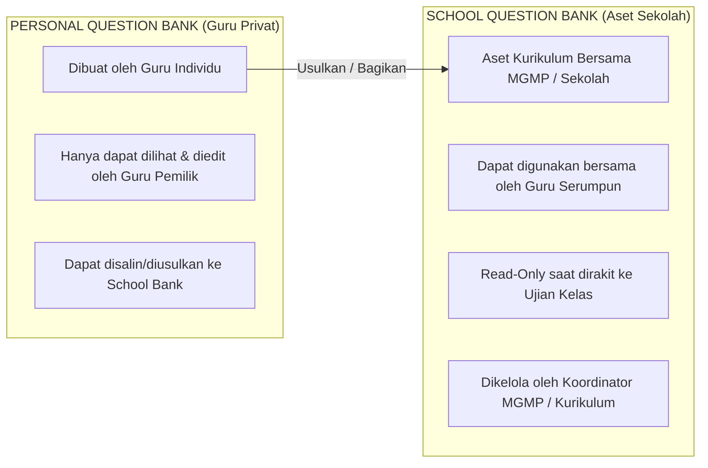

# UPDATED ASSESSMENT ENGINE BLUEPRINT
## Ruang Pintar — School Digital Operating Platform
### STAGE CBT-01: Cetak Biru Arsitektur Terpadu Penilaian, Kurikulum Merdeka, Administrasi Ujian & Asisten AI

| Metadata | Nilai Canonical |
| --- | --- |
| **Produk / Sub-sistem** | Ruang Pintar — Unified Assessment & Evaluation Platform |
| **Kode Tahap** | `STAGE CBT-01 (REFINED)` |
| **Status Dokumen** | `READY FOR HUMAN REVIEW` |
| **Klasifikasi Modul** | Core Academic Experience (M13 Assessment & Gradebook + M14 CBT Platform) |
| **Versi Dokumen** | 3.0 (Comprehensive Architectural Blueprint) |
| **Tanggal Terbit** | 7 Oktober 2026 |
| **Prinsip Utama** | *CP–TP–KKTP Lineage*, *Complete Assessment Administration*, *Dual Question Bank Ownership*, *AI-Ready Capability*, *Realistic Staged Delivery* |

---

# 1. Visi & Arsitektur Ekosistem Penilaian Terpadu

Assessment Engine Ruang Pintar 3.0 ditransformasikan dari sekadar instrumen penguji daring menjadi **School Digital Operating Platform for Assessment & Evaluation**. Sistem mengintegrasikan secara penuh siklus hulu-ke-hilir: dari perumusan capaian kurikulum nasional, administrasi ujian resmi, bank soal kolaboratif, pelaksanaan CBT yang tahan kendala jaringan, hingga pelaporan buku nilai dan diagnosis kompetensi peserta didik.

```text
┌────────────────────────────────────────────────────────────────────────────────────────┐
│                   KURIKULUM NASIONAL & CAPAIAN PEMBELAJARAN (CP)                       │
└───────────────────────────────────────────┬────────────────────────────────────────────┘
                                            ▼
┌────────────────────────────────────────────────────────────────────────────────────────┐
│                      TUJUAN PEMBELAJARAN (TP) & INTERVAL KKTP                          │
└───────────────────────────────────────────┬────────────────────────────────────────────┘
                                            ▼
┌────────────────────────────────────────────────────────────────────────────────────────┐
│                       BLUEPRINT / KISI-KISI ASESMEN RESMI                              │
├───────────────────────────────────────────┬────────────────────────────────────────────┤
│         KONTEN & REPOSITORI SOAL          │           ADMINISTRASI UJIAN RESMI         │
│  • Personal Question Bank (Privat Guru)   │  • Format Matriks Kisi-Kisi Resmi          │
│  • School Question Bank (Aset MGMP)       │  • Kartu Soal Lengkap per Butir            │
│  • Stimulus Kaya (KaTeX, Arab RTL, Audio) │  • Naskah Ujian PDF Ber-kop Surat Sekolah  │
│  • Kunci & Pedoman Penskoran / Rubrik     │  • Kunci Jawaban & Panduan Koreksi         │
└───────────────────────────────────────────┴────────────────────────────────────────────┘
                                            ▼
┌────────────────────────────────────────────────────────────────────────────────────────┐
│                        DELIVERY ENGINE: MULTI-MODAL ASSESSMENT                         │
├───────────────────────────────────────────┬────────────────────────────────────────────┤
│       DIGITAL CBT ENGINE (ONLINE)         │       HYBRID & PERFORMANCE ASSESSMENT      │
│  • Server-Authoritative Timer & Deadline  │  • Lembar Jawaban Manual / Cetak Kertas    │
│  • Offline-Resilient Idempotent Autosave  │  • Rubrik Penilaian Kinerja & Portofolio   │
│  • Proctor Monitoring Cockpit             │  • Berita Acara & Daftar Hadir Terintegrasi│
└───────────────────────────────────────────┴────────────────────────────────────────────┘
                                            ▼
┌────────────────────────────────────────────────────────────────────────────────────────┐
│                   PSYCHOMETRICS, EVALUASI & AI ASSESSMENT ASSISTANT                    │
│  • Autograding Instan Butir Objektif & Blind Grading Butir Esai Manual                 │
│  • Item Analysis Ilmiah: Tingkat Kesukaran (P), Daya Pembeda (D), Efektivitas Distraktor│
│  • AI Assessment Assistant: Diagnosis Ketuntasan TP & Generator Remedial Terarah       │
└───────────────────────────────────────────┬────────────────────────────────────────────┘
                                            ▼
┌────────────────────────────────────────────────────────────────────────────────────────┐
│                 LEGER AKADEMIK, E-RAPOR & PUBLIKASI RESMI TERKENDALI                   │
│  • Sinkronisasi Otomatis ke M13 Gradebook & Buku Induk Nilai Kurikulum Merdeka        │
│  • Portal Siswa: Umpan Balik Belajar, Refleksi Kompetensi, Pembahasan Butir Soal       │
│  • Portal Wali Murid: Pantauan Capaian Nilai & Catatan Perkembangan Belajar            │
└────────────────────────────────────────────────────────────────────────────────────────┘
```

---

# 2. Pilar Domain 1: Rantai Kurikulum & Assessment Blueprint

Assessment sekolah di Indonesia diwajibkan berbasis **Kurikulum Merdeka** (dan kompatibel dengan Kurikulum 2013). Asesmen tidak boleh hanya berbasis Bab/Topik tanpa keterikatan capaian.

### 2.1. Rantai Silsilah Akademik (Academic Lineage Chain)
Setiap instrumen penilaian wajib memiliki silsilah domain:
$$\text{CP} \longrightarrow \text{TP} \longrightarrow \text{KKTP} \longrightarrow \text{Blueprint / Kisi-kisi} \longrightarrow \text{Butir Soal} \longrightarrow \text{CBT Sesi}$$

1. **Capaian Pembelajaran (CP):**
   - Kompetensi pembelajaran yang harus dicapai peserta didik pada setiap fase perkembangan (Fase E: Kelas 10, Fase F: Kelas 11–12, Fase D: Kelas 7–9, dsb.).
   - Disimpan di tingkat master mata pelajaran dan jenjang/fase sekolah.
2. **Tujuan Pembelajaran (TP):**
   - Penjabaran kompetensi spesifik yang diturunkan dari CP untuk lingkup semester atau rombel belajar.
3. **Kriteria Ketercapaian Tujuan Pembelajaran (KKTP):**
   - Tolok ukur ketercapaian kompetensi per TP. Mendukung 3 pendekatan resmi Kemendikbud:
     - *Pendekatan Rubrik:* Deskripsi bertingkat (Perlu Bimbingan, Cukup, Baik, Sangat Baik).
     - *Pendekatan Deskripsi Kriteria:* Daftar kriteria esensial yang harus dipenuhi.
     - *Pendekatan Skala / Interval Nilai:* Ambang skor tuntas (misal: $\ge 75.0$).
4. **Blueprint Asesmen & Kisi-Kisi:**
   - Rancangan instrumen yang memetakan komposisi soal:
     - Distribusi Level Kognitif: L1 (Mengingat/Memahami), L2 (Menerapkan), L3 (Menalar/Menganalisis/HOTS).
     - Sebaran Bentuk Soal: Pilihan Ganda Tunggal, PG Kompleks, Benar/Salah, Menjodohkan, Isian Singkat, Esai Uraian.
     - Bobot skor per butir dan target waktu pengerjaan.

---

# 3. Pilar Domain 2: Assessment Administration (Administrasi Ujian Lengkap)

Guru dan institusi sekolah di Indonesia memiliki beban administratif formal yang tinggi. Platform menyediakan generator dan pencatatan resmi instrumen administrasi ujian yang dapat diakses digital maupun dicetak:

```text
┌────────────────────────────────────────────────────────────────────────────────────────┐
│                        PAKET ADMINISTRASI UJIAN RESMI SEKOLAH                          │
├────────────────────────────────────────────────────────────────────────────────────────┤
│ 1. KISI-KISI UJIAN RESMI                                                               │
│    Matriks tabel standar supervisi: Jenjang, Mapel, Fase, CP, TP, Materi,             │
│    Indikator Soal, Level Kognitif (L1/L2/L3), Bentuk Soal, Nomor Soal, Bobot Skor.     │
├────────────────────────────────────────────────────────────────────────────────────────┤
│ 2. KARTU SOAL (PER BUTIR SOAL)                                                         │
│    Dokumen satu lembar per butir soal: Rumusan butir pertanyaan, stimulus gambar/teks, │
│    kunci jawaban, rubrik penskoran, tingkat kesulitan, dan sumber buku/modul ajar.     │
├────────────────────────────────────────────────────────────────────────────────────────┤
│ 3. NASKAH SOAL UJIAN RESMI (PDF BER-KOP SURAT)                                         │
│    Naskah ujian format 2 kolom hemat kertas ber-kop surat resmi sekolah, petunjuk      │
│    umum, petunjuk khusus, dan tata letak profesional siap cetak.                       │
├────────────────────────────────────────────────────────────────────────────────────────┤
│ 4. KUNCI JAWABAN & PEDOMAN PENSKORAN                                                   │
│    Dokumen panduan koreksi resmi bagi guru dan tim pemeriksa, memuat kunci pilihan     │
│    objektif dan pedoman rubrik bertingkat untuk soal esai/uraian.                      │
├────────────────────────────────────────────────────────────────────────────────────────┤
│ 5. DAFTAR HADIR PESERTA UJIAN (ONLINE & CETAK)                                         │
│    Lembar presensi peserta di ruang ujian: Nomor peserta, nama siswa, NIS/NISN, status  │
│    kehadiran (Hadir/Izin/Sakit/Alpha), perangkat yang digunakan, dan tanda tangan.     │
├────────────────────────────────────────────────────────────────────────────────────────┤
│ 6. BERITA ACARA PELAKSANAAN UJIAN                                                      │
│    Laporan resmi pengawas ruang: Tanggal, jam mulai, jam selesai, mata pelajaran,       │
│    jumlah peserta terdaftar, hadir, tidak hadir, catatan insiden/gangguan teknis,      │
│    serta tanda tangan proktor dan penanggung jawab ujian.                              │
├────────────────────────────────────────────────────────────────────────────────────────┤
│ 7. ANALISIS BUTIR SOAL & DAYA SERAP                                                    │
│    Laporan psikometri pasca-ujian: Tingkat kesukaran, daya pembeda, sebaran distraktor,│
│    persentase ketuntasan rombel, dan daya serap materi per TP.                         │
└────────────────────────────────────────────────────────────────────────────────────────┘
```

---

# 4. Pilar Domain 3: Question Bank Ownership (Personal vs School)

Untuk menjaga hak kekayaan intelektual guru tanpa menghambat kolaborasi kurikulum sekolah, Bank Soal dibagi secara tegas:



### Aturan Domain & Isolasi Multi-Tenant:
1. **Personal Question Bank:**
   - Dibuat dengan atribut `scope_kepemilikan = "PERSONAL"` dan `guru_pemilik_id = [id_guru]`.
   - Query data mewajibkan filter `WHERE sekolah_id = [tenant_id] AND guru_id = [current_guru_id]`. Guru lain dalam sekolah yang sama **tidak dapat melihat maupun memodifikasi** butir soal ini.
2. **School Question Bank:**
   - Dibuat dengan atribut `scope_kepemilikan = "SEKOLAH"`.
   - Dapat diakses oleh seluruh guru di sekolah tersebut yang memiliki penugasan mengajar pada mata pelajaran atau rumpun keilmuan yang bersesuaian (`MataPelajaran.kelompok` atau `mata_pelajaran_id`).
   - Guru pengguna hanya dapat menyalin (*fork*) atau merujuk butir soal ke dalam ujian kelas masing-masing tanpa dapat merusak naskah master (*immutable master*).
   - Hak sunting master hanya diberikan kepada Koordinator Kurikulum atau Guru Pembuat asli.
3. **Tenant Isolation Guard:** Seluruh bank soal (baik personal maupun sekolah) terikat permanen pada `sekolah_id`. Dilarang keras terjadi kebocoran soal antarsekolah pada arsitektur SaaS multi-tenant.

---

# 5. Pilar Domain 4: AI Assessment Assistant Framework

Platform menyiapkan arsitektur terpadu bagi asisten kecerdasan buatan (berbasis Google Gemini) untuk membantu efisiensi guru tanpa menggantikan keputusan manusia:

### 5.1. Kemampuan Generatif (AI Generative Capabilities)
1. **Generator Kisi-Kisi Asesmen:**
   - Input: Deskripsi CP, daftar TP, jumlah soal yang diinginkan, dan distribusi level kognitif (L1: 30%, L2: 50%, L3: 20%).
   - Output: Draf tabel kisi-kisi terstruktur lengkap dengan indikator soal dan rekomendasi bentuk soal.
2. **Generator Butir Soal & Stimulus Kontekstual:**
   - Menghasilkan butir soal berkualitas tinggi berbasis stimulus dunia nyata, studi kasus, teks bacaan literasi, atau diagram sains.
3. **Penyusun Opsi Distraktor Masuk Akal (Plausible Distractor Generator):**
   - Menghasilkan opsi pengecoh (A, B, C, D, E) yang mencerminkan miskonsepsi umum peserta didik (*common student misconceptions*), bukan opsi konyol atau asal tebak.
4. **Generator Rubrik Penskoran & Pembahasan Komprehensif:**
   - Menghasilkan rubrik evaluasi esai bertingkat dan teks pembahasan edukatif yang ramah siswa untuk pembelajaran mandiri.
5. **Generator Paket Soal Remedial Terarah:**
   - Mengidentifikasi TP yang belum tuntas, lalu menghasilkan paket soal latihan baru yang memiliki tingkat kesukaran dan indikator setara (*parallel forms*).

### 5.2. Kemampuan Analitis (AI Analytical Capabilities)
1. **Diagnosis Ketuntasan TP Kelas:**
   - Menganalisis sebaran jawaban salah peserta didik dan memetakan akar penyebab kelemahan pemahaman konsep (*root-cause learning gap*).
2. **Evaluasi Kualitas Instrumen & Bias Soal:**
   - Mendeteksi kalimat ambigu, bahasa yang membingungkan (*double-barrelled questions*), atau kunci jawaban ganda sebelum ujian diterbitkan.
3. **Penyimpul Narasi Capaian Rapor:**
   - Menghasilkan draf deskripsi capaian kompetensi e-Rapor Kurikulum Merdeka yang humanis dan bervariasi sesuai capaian aktual setiap peserta didik.

---

# 6. Audit & Pentahapan Prioritas (Roadmap Realistis Sekolah Indonesia)

Berdasarkan audit kondisi riil sekolah di Indonesia (konektivitas Wi-Fi sekolah yang fluktuatif, ragam perangkat ponsel siswa beranggaran terbatas dengan memori terbatas dan notifikasi aplikasi yang aktif, serta kebutuhan administrasi pengawas dinas):

```text
┌────────────────────────────────────────────────────────────────────────────────────────┐
│                        ROADMAP PENTAHAPAN IMPLEMENTASI CBT                             │
├────────────────────────────────────────────────────────────────────────────────────────┤
│ TAHAP 1: MVP (FOKUS: STABILITAS PENGERJAAN, ADMINISTRASI & KURIKULUM)                 │
│ • CP -> TP -> KKTP -> Kisi-Kisi -> Bank Soal -> CBT Pipeline                           │
│ • Paket Administrasi Resmi Siap Cetak (Kisi-kisi, Kartu Soal, Naskah PDF, Berita Acara)│
│ • Dual Question Bank (Personal Bank & School Bank)                                     │
│ • CBT Player Tahan Putus Koneksi (Offline-Resilient Idempotent Autosave)                │
│ • Token Sesi Standar (1 Token per Ujian) & Timer Server-Authoritative                  │
│ • Autograding Objektif Instan & Koreksi Esai Manual Sederhana                          │
│ • Integrasi Satu-Klik ke Buku Nilai (Gradebook M13) & e-Rapor                          │
├────────────────────────────────────────────────────────────────────────────────────────┤
│ TAHAP 2: PHASE 2 (FOKUS: LIVE PROCTORING GRID & PSIKOMETRI ANALITIK)                   │
│ • Live Proctor Grid Layar Penuh (Monitoring Status Peserta Real-Time & Progres No. X/Y)│
│ • Deteksi Pindah Tab Humanis (Log Event Integritas tanpa Auto-Lock Agresif)            │
│ • Reset Sesi Perangkat (Device Rescue) saat HP Mati / Baterai Habis                    │
│ • Analisis Butir Soal Ilmiah (Tingkat Kesukaran P, Daya Pembeda D, Distraktor)         │
│ • AI Assessment Assistant: Draf Kisi-kisi, Butir Soal & Remedial Generator             │
├────────────────────────────────────────────────────────────────────────────────────────┤
│ TAHAP 3: PHASE 3 (FOKUS: HIGH-STAKES STRICT SECURITY & ADAPTIVE EXAM)                  │
│ • Dynamic Rolling Token (Auto-Refresh 15 Menit untuk Ujian Bersama Antar-Kelas)       │
│ • Watchdog Strike 3x Lock (Kunci Sesi Otomatis dengan Approval Proktor)                │
│ • Kiosk Browser / Safe Exam Browser Protocol Lock                                      │
│ • Computerized Adaptive Testing (CAT) & Advanced Item Banking                          │
└────────────────────────────────────────────────────────────────────────────────────────┘
```

---

# 7. Navigation Architecture Terintegrasi

Hierarki rute navigasi guru, siswa, dan proktor dirancang terstruktur:

```text
GURU & KURIKULUM
├── /cbt-ujian                                (Dashboard Hub Evaluasi & Penjadwalan)
│   ├── /bank-soal                            (Repositori Bank Soal: Tab Personal & Tab Sekolah)
│   │   ├── /buat                             (Editor Soal: KaTeX, Arab RTL, Media, Alignment TP)
│   │   └── /kategori                         (Folder Bank Soal per Topik / Bab)
│   ├── /kisi-kisi                            (Pusat Penyusunan Kisi-Kisi & Kartu Soal)
│   ├── /jadwal/buat                          (Wizard Perakitan Asesmen dari Kisi-kisi & TP)
│   ├── /proctor/[ujianId]                    (Layar Pengawas: Proctor Cockpit)
│   ├── /administrasi/[ujianId]               (Pusat Cetak Berita Acara, Naskah PDF, Daftar Hadir)
│   ├── /evaluasi/[ujianId]                   (Workspace Blind Grading Koreksi Esai)
│   └── /analitik/[ujianId]                   (Laporan Analisis Butir Soal P & D)
├── /penilaian                                (Buku Nilai & Ledger Rapor Kurikulum Merdeka)
└── /kelas-saya/[rombelId]                    (Tab Asesmen Kontekstual Kelas)

SISWA
├── /cbt-ujian                                (Portal Jadwal & Riwayat Ujian Siswa)
├── /cbt/start?ujianId=[id]                   (Pintu Masuk & Verifikasi Token Ujian)
├── /cbt/[attemptId]                          (Secure CBT Player — Pengerjaan Fokus)
├── /cbt/selesai/[attemptId]                  (Layar Konfirmasi Penyerahan Selesai)
└── /cbt/hasil/[attemptId]                    (Umpan Balik & Pembahasan Pasca Publikasi)

WALI MURID
└── /nilai-anak                               (Portal Pantauan Capaian Nilai & Capaian TP Anak)
```

---
*Dokumen ini merupakan pembaruan resmi arsitektur Assessment Engine Ruang Pintar 3.0 dan siap untuk ditinjau oleh Human Project Owner.*
